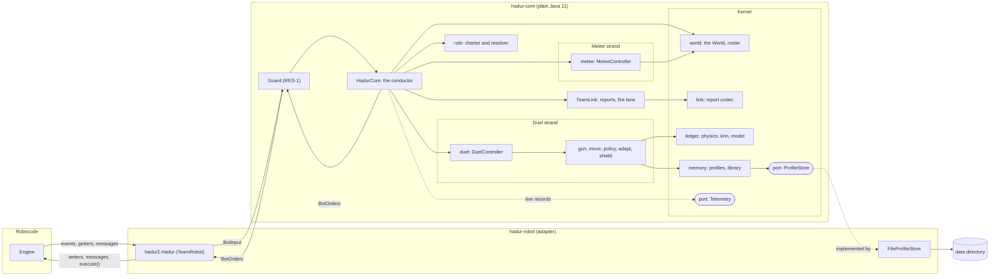
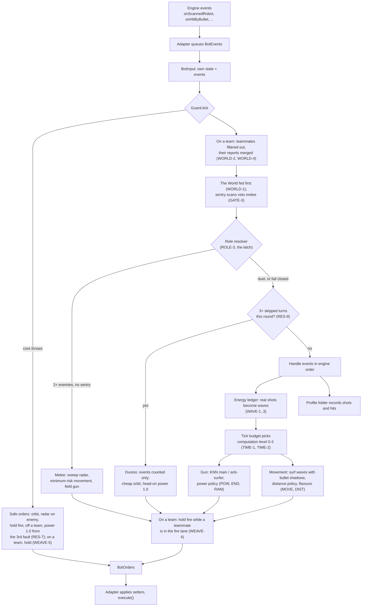
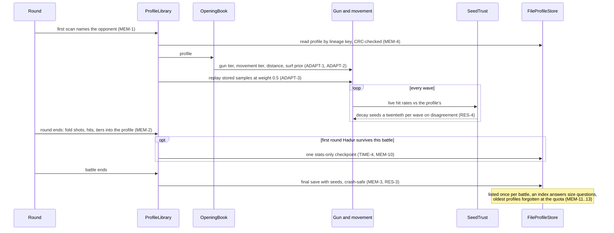
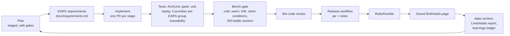

# Hadur 2

**Hadur** (the Hungarian god of war) is a [Robocode](https://robocode.sourceforge.io/) robot:
a 1v1 duelist that remembers each opponent across battles, with a melee brain for
free-for-alls, a five-robot team entry, and a core that has no idea it is inside Robocode.

**Hadur 3.20 is ranked 3rd of 1,222 in the RoboRumble 1v1** (91.82 APS, its best ever), 3rd of 48 in the
TeamRumble (HadurTeam 3.20, 81.51, its best ever) and 14th of 418 in the MeleeRumble (67.76), the highest-ranked
robot flying the Irish flag. Around it is a [family of smaller robots](#family-of-robots), two of
them 1st in their rumbles and two more 2nd. All of it was designed, written, tested and tuned by Claude agents
working in a shared project with one human, Leigh Griffin, who set the goals and ran the live
entries.

## In homage to Deep7

Hadur owes its start to [**wit.Deep7**](http://robocode-archive.strangeautomata.com/robots/wit.Deep7_2.0.jar),
the robot that won the **2004 Irish Robocode championship**. Deep7 was designed by
Bill Malone, Leigh Griffin and Patrick Ffrench as part of the Applied Computing course
at Waterford Institute of Technology (the `wit` in its name). Building it is how we
learned Java, and it was the original inspiration for everything on this page.

## Standing

**3.20 was released on 2026-10-30.** The live rankings read on 2026-10-30 at 21:41 UTC (1v1 pages) and
21:50 UTC (team and melee, from the LiteRumble API):

| Rumble | Entry | Rank | APS | Pairings | Battles |
|---|---|---|---|---|---|
| 1v1 | `hadur117.Hadur 3.20` | **3rd of 1,222** | **91.82** ± 0.22 | 1,221 | 1,403 |
| Team | `hadur117.HadurTeam 3.20` | **3rd of 48** | **81.51** | 45 of 47 | 172 |
| Melee | `hadur117.Hadur 3.20` | 14th of 418 | 67.76 | 417 | 6,109 |

- **1v1 3rd at 91.82, its best score ever**, past Saguaro (91.76) by 0.06, inside one error bar.
  DrussGT, 2nd, is 0.74 ahead and BeepBoop, 1st, 3.16. +0.24 ± 0.23 over 3.19 on the same 1,220
  opponents. The aim members (MOVE-29) gained +0.14 on the 383 simple guns and +0.12 on the 136 surfers
  the rivals shield, the two groups where Saguaro led 3.19. PWIN 99.18% (10 pairings lost, all single
  battles), vote 12.05, 2nd to BeepBoop ([1v1 live notes](docs/bench/live-3.20.md),
  [3.20 notes](docs/releases/v3.20.md)).
- **Team 3rd at 81.51, its best ever** (first pass, 2 pairings to go): 3.19 plus Ogi-style dodging with an
  own-fire check and a path that keeps teammates out of the line of fire. CombatTeam is 2nd at 81.65,
  FirestarterTeam 4th at 81.47 and OgiTeam 1st at 88.09.
- **Melee 14th at 67.76**, unchanged play from 3.19 (67.75). 10th is 68.22.
- **Why 3.18 read 10th first.** 3.18 read 87.73 on code that plays bit for bit as 3.17: 98.6% of its
  1v1 battles came from one PC client that scored about 3 points under clean pairings. 3.18.1
  restarted the pages with that client off the live rumble.

Each release's live notes are in [docs/bench/](docs/bench/) (`live-*.md`) and its saved pages in
[data/rumble/](data/rumble/).

### Rank history

| Release | Date | Live APS | Survival | Rank | What changed |
|---|---|---|---|---|---|
| 3.0 | 2026-09-28 | 81.57 | 82.6% | 64th | Hadur 2 duelist (S0-S6) and the rebuilt melee brain (M0-M6) |
| 3.1 | 2026-09-30 | 81.46 | 83.0% | 16th in its first hour, 65th at the end | R1-R3: client reliability, full power vs weak bots, a gun for surfers |
| 3.4 | 2026-10-01 | 85.90 | 93.9% | 20th (28th melee) | R5-R8: rumble-safe memory, duress mode, movement, memory that stays cheap |
| 3.5.1 | 2026-10-03 | 86.65 | 94.4% | 16th (18th melee) | R9, the ram approach: run from rammers (RAM-2), a planned path against mirror movers (MIR-1) |
| 3.7 | 2026-10-05 | 85.67 | | 21st (18th melee, 32nd team) | A0-A5, the architecture evolution, and the first team entry |
| 3.8 | 2026-10-06 | 84.58 | 91.8% | 29th (16th melee, 12th team) | D1-D5, the DrussGT route, and T1, teammates that no longer collide |
| 3.8.5 | 2026-10-06 | 84.79 | 92.0% | 24th | MATCH-1/2: the DrussGT aim and shield latch only in duels Hadur is not already winning |
| 3.9 | 2026-10-07 | 87.15 | 95.0% | 13th (19th melee, 12th team) | RAM-3, the rammer trial: escape a rammer only where its rounds show it pays |
| 3.10 | 2026-10-08 | 86.42 | 93.9% | 20th, 13th on its second pass (87.33) | The shield sweep: 83 more robots on the shield list (+0.51 APS live); the pass ran 1.25 APS under 3.9's on unchanged code ([live notes](docs/bench/live-3.10.md)) |
| 3.11 | 2026-10-10 | 87.56 | 95.1% | 13th (17th melee, 12th team) | Census-led: start-up duress (RES-9) retired, +0.25 APS live over 3.10 ([live notes](docs/bench/live-3.11.md)) |
| 3.12 | 2026-10-11 | 87.72 | 95.3% | 9th | SHIELD-7: the mirror aim fires against a shielder, so the gun no longer falls silent against mirror bots ([live notes](docs/bench/live-3.12.md)) |
| 3.13 | 2026-10-14 | 89.50 | 95.9% | 7th (17th melee, 9th team) | SHIELD-8..13: shield against 200 listed robots, holding fire and learning intercepted headings ([live notes](docs/bench/live-3.13.md)) |
| 3.15 | 2026-10-23 | 89.29 | | 8th (15th melee, 9th team) | SHIELD-14, MOVE-24, the melee gun (MGUN-7) and team shared gun learning (MGUN-8) ([live notes](docs/bench/live-3.15.md)) |
| 3.16 | 2026-10-24 | 89.25 | 95.3% | 8th (17th melee, 7th team) | Per-opponent mode table v1 and team stage 1 ([live notes](docs/bench/live-3.16.md)) |
| 3.17 | 2026-10-25 | 90.91 | 99.0% | 7th (16th melee, 4th team) | Mode table v2 (stop-and-go), shield parts 2 and 3, team step C ([live notes](docs/bench/live-3.17.md)) |
| 3.18 | 2026-10-27 | 87.73 | | 10th | TIME-9 (a third less garbage, bit for bit), melee MGUN-7, MEND-3 and MGUN-13; first pass came 98.6% from the PC release watch |
| 3.18.1 | 2026-10-27 | 91.34 | 96.7% | 4th (13th melee, 5th team) | 3.18's code on a clean page, PC clients off the live rumble ([notes](docs/releases/v3.18.1.md)) |
| 3.19 | 2026-10-28 | 91.58 | 96.9% | 4th (14th melee, 4th team) | Package `hadur117`; the rammer dodge (RAM-5), stop-and-go re-picks, team counters, melee power 3 to 300 px ([live notes](docs/bench/live-3.19.md)) |
| 3.20 | 2026-10-30 | **91.82** | 96.9% | **3rd** (14th melee, **3rd team**) | MOVE-29, the aim members: the surf also rates head-on, linear and circular aims; team PATH and DODGE with own fire ([live notes](docs/bench/live-3.20.md)) |

3.0 and 3.1 slid 5 to 8 APS within hours on live clients; a one-JVM session bench traced it to a
round-end profile save that grew with every opponent on disk, fixed in 3.4
([L-27](data/learnings.md), [skipped-turns plan](docs/skipped-turns-plan.md)).

## Family of Robots

Hadur has siblings, one for each size class and format it can win. Each is a separate robot with
its own folder, build, requirements and README, and none shares code with Hadur.
Live results as of 2026-10-30 21:50 UTC (each robot's README keeps its full history):

| Robot | Rumble | Size | Live result | |
|---|---|---|---|---|
| [**Hadur**](hadur-robot/) `hadur117.Hadur` | RoboRumble (1v1) | megabot | **3rd of 1,222**, 91.82 ± 0.22 (3.20, 2026-10-30) | [standing](#standing) |
| | MeleeRumble | | 14th of 418, 67.76 (3.20, 2026-10-30) | |
| [**HadurTeam**](hadur-robot/) `hadur117.HadurTeam` | TeamRumble | five Hadurs | **3rd of 48**, 81.51 (3.20, 2026-10-30, 45 of 47 pairings) | [standing](#standing) |
| [**TwinSaor**](twinsaor/) `hadur117.twin.TwinSaor` | Twin Duel (2v2) | 1,995 B of 1,999 | **1st of 28**, 70.28 ± 0.50 (0.2, 2026-10-28) | [README](twinsaor/README.md) |
| [**Saor**](saor/) `hadur117.micro.Saor` | MicroMelee | 723 B of 749 | **1st of 158**, 69.73 (0.3, 2026-10-30), 0.45 ahead of kc.micro.Figment | [README](saor/README.md) |
| [**Deise**](deise/) `hadur117.mini.Deise` | MiniMelee | 1,494 B of 1,499 | **2nd of 206**, 70.57 (0.4, 2026-10-30), 0.58 behind kc.mini.Mirage | [README](deise/README.md) |
| [**Sanaro**](sanaro/) `hadur117.nano.Sanaro` | NanoMelee | 247 B of 249 | **2nd of 90**, 65.15 (0.2, 2026-10-30), 1.26 behind d414.nano.Quantum | [README](sanaro/README.md) |
| [**JayLexi**](jaylexi/) `hadur117.mini.JayLexi` | MiniRumble (1v1) | 1,485 B of 1,499 | **5th of 671**, 87.34 (0.2, 2026-10-30), 1.67 behind sheldor.mini.FoilistMC | [README](jaylexi/README.md) |
| [**Eveimear**](eveimear/) `hadur117.micro.Eveimear` | MicroRumble (1v1) | 722 B of 749 | **9th of 516**, 83.28 (0.1, 2026-10-30), 2.32 behind 1st | [README](eveimear/README.md) |

- **TwinSaor** is two copies of one Saor-derived robot sharing radar and targets, with a range and
  mode table per opposing team ([docs/twinsaor.md](docs/twinsaor.md)).
- **Saor** is a Markov-gun micro melee bot that learns from every scan ([docs/saor.md](docs/saor.md)).
- **Deise** is a least-risk mini melee bot with seen-shot waves, built to take 1st from
  kc.mini.Mirage ([docs/deise.md](docs/deise.md)).
- **Sanaro** is a nano melee bot: anti-gravity, a branch-free radar, a gun that fires only on its lead
  and a table of bullet power by both robots' energy ([docs/sanaro.md](docs/sanaro.md)).
- **JayLexi** (a wave surfer with a GuessFactor gun) and **Eveimear** (stop-and-go movement over a
  GuessFactor gun) are 1v1 size bots from Leigh's kitlab design ([docs/kitlab.md](docs/kitlab.md)).

## What it does

One on one (the duel):

- **Sees the enemy's shots as they really are.** An energy ledger takes our hits, their
  refunds, wall and collision damage out of each energy drop, so only real shots become
  waves (WAVE-1, WAVE-2). Against Shadow 3.83c, 99.8% of the shots a scan can see become
  waves.
- **Surfs those waves and aims with KNN guns.** Guess-factor danger views, and a main and
  an anti-surfer gun chosen by virtual-gun ratings, as in Hadur 1.20.
- **Makes itself harder to hit.** Its own bullets in flight shadow the enemy's waves: the
  angles where an enemy bullet would be shot down are scored as safe (MOVE-1). When a
  known opponent hits it more than its profile says, the movement changes flavour (MOVE-2).
- **Remembers every opponent.** A profile per opponent (hit rates, gun and movement tiers,
  gun and surf samples) is folded in at each round's end and saved within Robocode's data
  quota, crash-safe (MEM-1..5, RES-3).
- **Recognises and adapts.** From the profile it picks its opening gun, surf prior and
  flattener, and replays stored samples at reduced weight; live evidence overrules the
  profile when they disagree (ADAPT-1..3, RES-4).
- **Presses when ahead.** A distance controller comes in while Hadur clearly out-hits the
  enemy, fires full power at guns that cannot hit it, and closes in to finish or ram a
  beaten enemy (DIST-1, POW-1, POW-2, END-1, END-2).
- **Beats bullet shielding.** An enemy that shoots our bullets down is recognised, and our
  aim is jittered so its shield shots miss (SHIELD-1, SHIELD-2).
- **Stays within its time.** A tick budget sheds work, a level at a time, after a slow tick
  or a skipped turn (TIME-1, TIME-2); after three skipped turns in a round it drops to a
  cheap duress mode rather than stall (RES-9).
- **Stays cheap on a rumble client.** Profiles stay small (stats only for most opponents),
  the data directory is listed once per battle, and the oldest profiles are forgotten at the
  quota, so a save stays cheap with hundreds of opponents on disk (MEM-8..13).

Every policy input carries a margin of error, and each policy keeps its conservative
setting until the evidence is certain enough (DIAL-1).

In melee (two or more opponents, no sentry on the field): a gate that falls back to the
duel on a sentry or a fault (GATE-1..5); a radar that keeps spinning with four or more
alive (MRADAR-1, MRADAR-2); minimum-risk movement with virtual bullets from every recorded
shot, clear of other robots' fights (MMOVE-1..5); a learning field gun that aims at every
opponent at once, with an energy table and exact kill shots (MGUN-1..5); and a melee
profile per opponent. When one opponent is left, its 1v1 profile and its shots in flight
go to the duel (MMEM-1, MMEM-2).


## Architecture

The full description is [docs/architecture.md](docs/architecture.md). Four pictures carry
most of it.

### Hexagonal: a core that does not know it is in Robocode

The strategy lives in `hadur-core`, which sees only plain values. A thin adapter turns
engine events into a `BotInput` and the core's `BotOrders` back into setter calls. ArchUnit
enforces the boundary on every build (CORE-1): no `robocode.*`, no randomness, threads, I/O
or clock in the core. That is what lets the same core be replayed, fuzzed, fault-injected
and benched without an engine.



### One tick

The adapter queues each event in the engine's priority order, builds a `BotInput`, and
calls the guard. On a team, the conductor first takes teammates out of the input and merges
their reports. It feeds the World, then the role resolver picks the role that drives this
tick: Melee or Duel, never both, and only ever stepping down within a round (a sentry
scanned this tick vetoes melee). That role handles the events and returns orders. On a
team, a shot is held while a teammate stands in the fire lane. If the core throws, the guard returns safe orders
(keep orbiting, radar on the enemy, hold fire; off a team, from the third faulting tick in
a round it fires power 1.0 at the enemy's last bearing when the gun is cool, RES-7; on a
team it always holds fire, WEAVE-5), so the robot never stalls.



### Opponent memory and adaptation

Each opponent has a profile on disk under a lineage key (`abc.Shadow 3.84` files as
`abc.Shadow`). The first scan loads it, the opening book turns it into choices, and live
evidence takes over wherever it disagrees with the profile by more than either margin of
error (DIAL-1, RES-4).



### The bench and the loop around it

Nothing merges on a hunch. `hadur-bench` runs real Robocode battles headless; each stage has
a gate the bench must show before merge, and the live rumble pages come back into the repo
as data, so the next plan starts from evidence.



## Built by agents: an exploration of AI and agentic design

Hadur 2 is as much an experiment in how AI agents build software as it is a robot. Hadur
1.x (up to 1.20) was evolved release by release, by feel. Hadur 2 was rebuilt from 2026-09-26
to 2026-10-01 by Claude sessions working in one shared project: 50 merged pull requests, about
24,000 lines of production Java and 12,000 of tests, from a 64th-place 3.0 to a 20th-place
3.4 (and, by 2026-10-11, a 9th-place 3.12). Leigh set the goals, made the calls only a human could (what "good" means, when to
enter the rumble), and carried the live entries; everything else was done by agents. What
follows is what made that work, and where it did not.

### Roles: a planner and implementers

Work was split by kind, not just by size. A planning model (Fable) read the evidence and
wrote each plan: the [Hadur 2 plan](https://claude.ai/artifact/KDkC1j5Yj8vWH6XQydyYH8)
(S0-S7), the melee extension (M0-M6), and the rumble climb ([R4-R6](docs/rumble-climb-r4-r6-plan.md),
[top 30](docs/rumble-climb-top30-plan.md), [memory at scale](docs/rumble-memory-scale-plan.md)).
Implementation threads (Sonnet) then built each plan stage by stage, one PR per stage. The
planner also reviewed: [the skipped-turns plan](docs/skipped-turns-plan.md) checks an
implementer's diagnosis against the raw session logs and the engine source, confirms the
cause, and corrects four points before the code was written. A coordinating session watched
the project chat, started a thread per ask, and kept the shared memory; each thread worked
alone on its task and reported back where it was asked.

### Requirements as the contract between agents

Every behaviour is an [EARS](docs/requirements.md) requirement (Ubiquitous, Event, State,
Unwanted, Optional), more than a hundred of them, each with a stable ID that never changes
meaning. A requirement is the unit an agent is asked to deliver, and the build holds it to
it: a traceability test fails `mvn verify` if any ID has no test, every Cucumber scenario is
tagged with the IDs it proves, and the Javadoc cites the IDs next to the code that meets
them. A planner can name `MEM-12` and an implementer days later, in a fresh session with no
memory of the plan, knows exactly what done means.

### Guardrails that do not depend on the agent remembering them

Agents start cold. Rules that live only in a prompt get lost, so the important ones are
enforced by the build:

- **ArchUnit** keeps the hexagon intact: no Robocode in the core, no randomness, threads,
  reflection, I/O or clock, and a fixed direction of dependencies between packages.
- **"1v1 is sacred."** `DuelIdentityTest` pins a hash of every duel source file, so melee work
  that touches the duel fails the build unless the PR re-pins it deliberately and says why.
- **Replay fixtures** of recorded battles fail on any unintended change of play; determinism
  (CORE-2) makes them exact.
- **Doclint** fails the build on a broken Javadoc link or a wrong `@param`.

### The bench as ground truth

Agents are fluent and confident; a bench is neither. Each stage had a numeric gate (score
share against Shadow, rounds won against the samples, APS in a reference melee field) with
95% intervals over seeds, and a stage merged only when the bench showed it. The bench grew
with the questions: cold and warm modes, a stratum-weighted estimate over the live rankings
(BENCH-1), paired-seed A/B (BENCH-2), client conditions (BENCH-4), a reader for live pages
(BENCH-5) and a 300-battle one-JVM session with a control robot (BENCH-6, BENCH-7). Ideas that
benched badly were dropped on the evidence: TIME-6 was built, measured as harmful, and
removed ([r8-memory-scale](docs/bench/r8-memory-scale.md)).

### Memory across sessions

A session's context ends; the project does not. Three layers carry what one agent learned to
the next:

- **The repository itself**: plans, bench reports, release notes and the
  [strategy evolution](docs/strategy-evolution.md).
- **[`data/`](data/)**: every saved rumble page byte for byte, parsed tables, flat bench
  history, and [a learnings ledger](data/learnings.md) of findings, each with its evidence
  and status (open or confirmed).
- **Project memory**: a shared note store every session reads at start, with decisions,
  conventions and hand-offs.

### Review by agents, for agents

Stage PRs went through an automated code review, and the implementing thread treated each
finding as a bug report. The record shows why: on PR #61 the review caught a power margin so tight the
rule could never fire live while its tests passed, a kill-power cap that could cost a
low-energy gun its shot, and a rammer detector reading our own movement as theirs
([strategy evolution, R2](docs/strategy-evolution.md)).

### What was hard

- **The bench and the rumble disagreed for three days.** 3.0 and 3.1 lost 5 to 8 APS within
  hours on live clients, and no bench reproduced it. It took a new kind of bench (one engine,
  300 battles, a control robot) to find the cause: the round-end save grew with the number of
  opponents on disk. Agents can only test what they can simulate; widening the simulation was
  the fix.
- **Sessions cannot reach everything.** The container could not push tags, reach the
  rumble's wiki, or play on a real client. Leigh saved the live pages and carried the entries,
  and releases moved to a workflow the agents can dispatch.
- **Speed against evidence.** When live passes were too slow for three releases, R5, R7 and
  R6 shipped together as 3.3 and their long gates moved to one end-of-plan pass, a trade made
  explicitly in the [3.3 notes](docs/releases/v3.3.md).


## Build and test

Java 17 or later, Maven 3.9. Hadur is compiled for Java 11 (REL-1) and the size-class siblings for
Java 8, so every RoboRumble client can load them.

```sh
mvn verify                  # all modules: tests, traceability, robot jars
```

The jars land in each module's `target/`: `hadur-robot/target/hadur2.Hadur_<version>.jar` with
`hadur2.HadurTeam_<version>.jar` beside it, and one jar per sibling. Drop a jar into a Robocode
`robots/` directory to play it. Releases run from GitHub Actions (`release.yml` for Hadur, and one
workflow per released sibling, such as `release-saor.yml`): each builds, checks the jar matches the version
(and the size limit for the small bots) and publishes a GitHub release with
`docs/releases/<tag>.md` as its notes. The latest release's assets are the jars the rumbles
download.

The tests are layered: ArchUnit rules, jqwik properties, unit tests, replay of recorded
battles, Cucumber scenarios per EARS group, and a traceability test that fails the build
if any requirement has no test. [docs/testing.md](docs/testing.md) describes each layer,
how to run them, and how to re-record the replay fixtures.

### The bench

```sh
mvn package -DskipTests
cd hadur-bench
mvn exec:java -Dexec.args="--mode cold --rounds 35 --seeds 5"
```

`--mode warm` keeps Hadur's profiles across battles; `--set melee-samples.txt --melee true
--field 1000x1000` plays a 10-robot melee. Details in [hadur-bench/README.md](hadur-bench/README.md).
Third-party opponents such as `abc.Shadow_3.83c.jar` go in `hadur-bench/opponents/` (not committed).

### Documentation

Every class in the core and the adapter carries Javadoc that explains how it works, why, and
which EARS requirements it implements; `mvn verify` runs doclint over all of it. `site/build.sh`
builds the docs site (Javadoc, a requirement map from every EARS ID to the classes and tests that
cite it, and the design docs), and the `pages` workflow publishes it to
https://lgriffin.github.io/Hadur_Robot/ on every push to master. The main design documents are
[docs/architecture.md](docs/architecture.md), [docs/requirements.md](docs/requirements.md) and
[docs/strategy-evolution.md](docs/strategy-evolution.md). Follow-ups are tracked as
[GitHub issues](https://github.com/lgriffin/Hadur_Robot/issues).

## Telemetry

Hadur prints line records to its console, which the bench collects. Fields are only ever
appended, so older readers keep working.

- `V,1`: format version, once per battle.
- `B,round,tick,battle,name,key,profileFound,tiers,gunSeed,surfSeed,computationLevel`: the
  opponent, on first scan, and what its profile said (MEM-1, ADAPT-1..3).
- `P,round,tick,policy,value,margin,setting`: a policy decision, with the estimate and
  margin behind it (DIAL-1). The policies are `opening-gun`, `surf-prior`, `gun-seed`,
  `surf-seed`, `distance`, `power`, `endgame`, `move-flavour` and `budget`.
- `EW,round,tick,waveId,fireTick,rawDrop,correctedDrop,power,distance`: each enemy wave the
  energy ledger infers. `rawDrop` is what 1.20 would have used.
- `R,round,tick,result,...`: once per round, 33 fields: the energies, both hit rates with
  their margins, and every counter the core keeps (RES-5). The field list is in
  [RoundStats](hadur-core/src/main/java/hadur2/core/RoundStats.java).
- `MEM,round,tick,what,note`: a profile that failed to load, fold or save (MEM-3, MEM-4).
- `FAULT,round,tick,exception`: the first time in a round the guard has to cover for the core.

## History

Hadur 1.x (up to 1.20) was a dual-mode duel and melee robot, evolved release by release by
feel. Hadur 2 started as a pure duelist rebuilt around a measured bench; release 2.1 ported
the 1.x melee work (from the `claude/project-thread-3j7vn4` branch) into the core's `melee`
package for the MeleeRumble. The 1.x feature files are kept in
[docs/legacy-features](docs/legacy-features).
