# Hadur architecture: one robot, three styles

This is the architecture of Hadur as it stands on `master` (2026-10-31, after release 3.20). It
covers the three styles of battle Hadur plays, **1v1** (RoboRumble), **melee** (MeleeRumble) and
**team** (TeamRumble), and the code they share. The diagrams follow the C4 model: context,
containers, components, and code where it helps. Every switch, mode table and ablation is
catalogued in [Switches and mode tables](#switches-and-mode-tables).

It supersedes the diagrams of [architecture.md](architecture.md) (which stays as the detailed
narrative of each subsystem) and the A0 to A5 plan in
[architecture-evolution.md](architecture-evolution.md), whose end state this describes.
Requirement IDs (ROLE-3, TMODE-34 and so on) are those of [requirements.md](requirements.md).

## The three styles at a glance

| | 1v1 | Melee | Team |
|---|---|---|---|
| Rumble | RoboRumble | MeleeRumble (10 robots) | TeamRumble (5 v 5) |
| Jar | `hadur117.Hadur_<v>.jar` | the same jar | `hadur117.HadurTeam_<v>.jar`: five `hadur117.Hadur` |
| Charter (fixed at tick 0, ROLE-1) | `DUEL` | `MELEE` | `TEAM` |
| Brains built (ROLE-6) | Duel only | Melee, then Duel | Melee, then Duel (the Team role is not built) |
| Who drives | `DuelController` every tick | `MeleeController` while 2+ opponents live, then `DuelController` | the same as melee, with `TeamLink` wrapped round both |
| Per-opponent table | the 1v1 mode table (`ShieldList`, from the robot jar's data classes) | none | the team mode table (`TeamModes.TABLE`) |
| Memory shelf written | `.hp` profiles | `.hm` blocks | health record only, by the leader |
| Standing (3.20 live) | 3rd, 91.82 | 14th, 67.77 | 3rd, 81.51 |

The one rule that runs through all of it: **team and melee changes must never change how Hadur
plays a 1v1.** [The isolation rule](#the-isolation-rule) shows the eight mechanisms that hold it.

## Level 1: system context

Hadur is one robot that the Robocode engine runs on every ladder. Nothing outside the engine
talks to it during a battle; everything else (the bench, the rumble clients, the release
workflow) works on the jar.

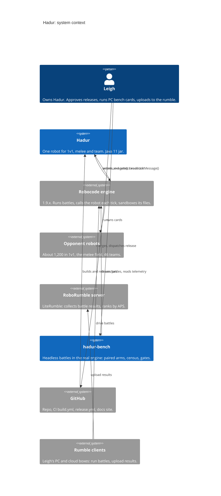

The family's small robots (Saor, TwinSaor, Deise, Sanaro, JayLexi, Eveimear) live in the same repo
as their own Maven modules and **share no code with Hadur**. They are out of scope here.

## Level 2: containers

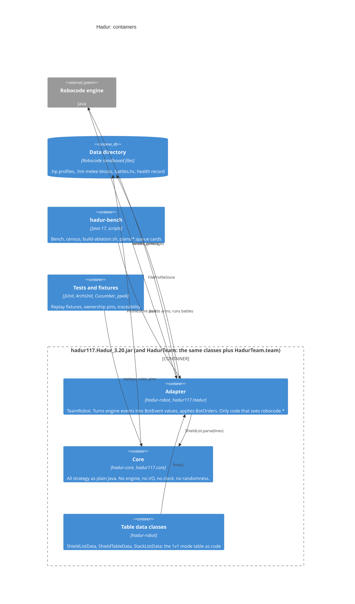

| Container | Role | Connects through |
|---|---|---|
| **Adapter** `hadur117.Hadur` | The robot class. Queues engine events as `BotEvent` values in the engine's order, builds a `BotInput` from the getters, calls `Guard.tick`, applies `BotOrders` (NaN = leave the setting, fire 0 = hold), then `execute()`. Keeps the core in a static so learning survives the new robot object Robocode makes each round. Measures each tick and feeds it back as a `TickTime` event, so the core never reads a clock. | `BotInput`/`BotOrders`; `ProfileStore`; `Telemetry` lines on the console |
| **Core** `hadur117.core` | The brain: a conductor, three strands and a shared kernel (Level 3). Deterministic: the same inputs give the same orders (CORE-2). | Only the ports |
| **Table data classes** | The 1v1 per-opponent mode table, written as Java because the sandbox will not let a robot read a resource from its own jar. | `Hadur.shieldList()` prefixes each line and hands them to `ShieldList.parse` |
| **Data directory** | Robocode's per-robot sandboxed folder with a byte quota. In a team battle all five members share it. | `FileProfileStore`, which writes through `RobocodeFileOutputStream` |
| **hadur-bench** | Runs the real engine headless: paired arms on shared seeds, A/A controls, census over the whole field, live-watch. Builds variant jars with `build-ablation.sh`. | Builds jars from the source tree; reads telemetry |
| **Tests** | ArchUnit layering, strand ownership and pins, replay fixtures, requirement traceability. | Run on every build |

### The team as containers

A team is five copies of the same jar's classes, one per robot thread, each with its own core.
They share nothing in memory. They talk only through the engine's message bus, one tick late,
and they share one data directory.

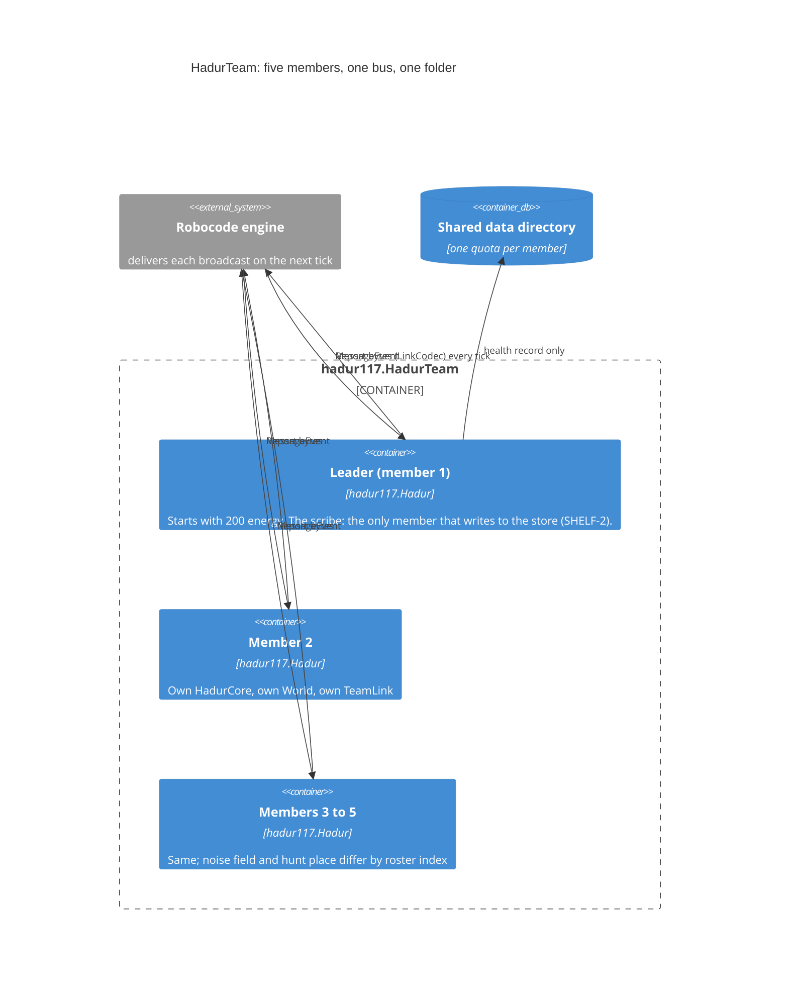

## Level 3: the core's owners

Every package of the core has exactly one owner, written in
`hadur-core/src/test/resources/ownership.txt` (STRAND-1). The owners are layered: kernel under
strands under conductor (STRAND-2), enforced by ArchUnit on every build.

| Owner | Packages | Job |
|---|---|---|
| **Conductor** | root `hadur117.core` (HadurCore, Guard, DuelSeam, MeleeSeam, TeamLink, Archive, MeleeMemory), `role`, `replay` | Runs the tick. Fixes the charter, picks the role, routes events, gives the fire permission, applies fences, owns the hand-off and the team link. |
| **Duel strand** | `duel`, `gun`, `move`, `adapt`, `policy`, `shield`, `shieldmode` | Everything against one opponent. |
| **Melee strand** | `melee` | Everything against a crowd, **and today all team tactics** (TeamModes, TeamConcord, TeamDodge, TeamDanger), gated on having a living teammate. |
| **Team strand** | none yet (`pins/team.sha256` is empty, `RoleResolver.TEAM_BUILT = false`) | Reserved. Team behaviour lives in the conductor's `TeamLink` and the melee strand. |
| **Kernel** | `model`, `physics`, `knn`, `ledger`, `memory`, `port`, `world`, `link` | What every strand shares: port values, engine rules, kd-trees, the energy ledger, opponent memory, the World, the link codec. |

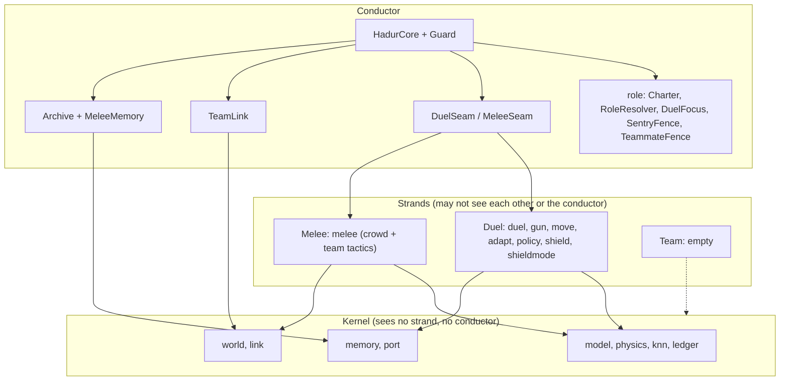

### Shared components (conductor and kernel)

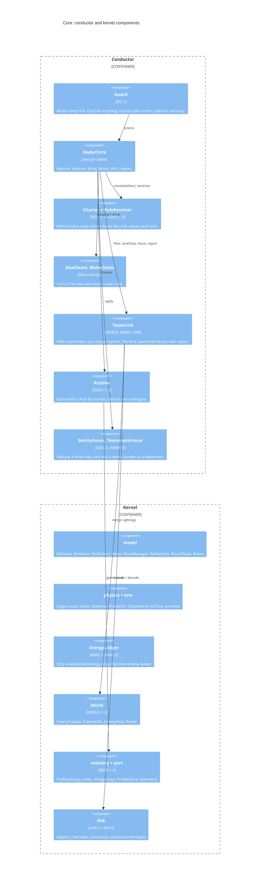

### The tick, end to end

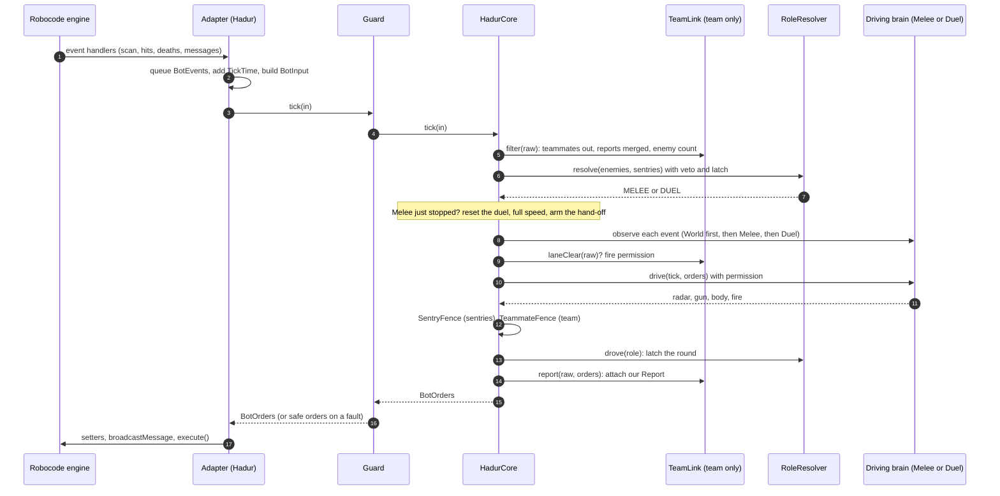

Five things in that flow carry the whole design:

1. **The charter** is fixed once from `BattleFacts` (teammates? two or more enemies?) and decides
   which brains are even built. A 1v1 never constructs a melee brain, a World, a melee seam or a
   team link (ROLE-6).
2. **The role** is resolved every tick from the charter, the counts, the vetoes and a latch that
   only lets the role step down a round (ROLE-4): Melee, then Duel, never back.
3. **Observation is wide, driving is narrow.** Every event is offered to every role in the charter
   (World first), so the Duel keeps its bullet books even while Melee drives. Only the driving role
   writes orders (WEAVE-1), and only with the conductor's fire permission (WEAVE-3).
4. **Fences only replace a drive** (WEAVE-2): gun, radar, fire and messages pass through.
5. **The Guard** makes a fault a single bad tick: safe orders, a `FAULT` line, a recovery that keeps
   everything learned (RES-1). A melee fault vetoes Melee for the round and the Duel takes over
   (GATE-4).

### Role resolution

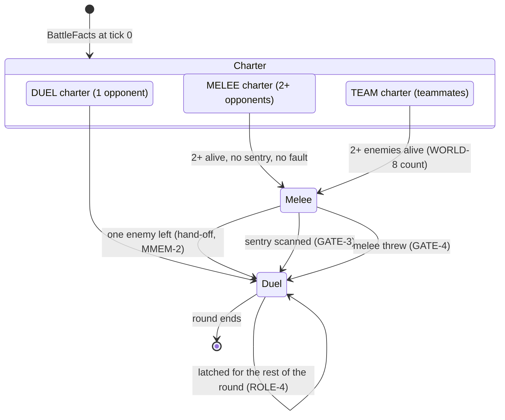

When the Duel drives with several opponents alive (after a veto), `DuelFocus` names one, the
closest at take-over, kept until it dies; the others reach only the World. On a team the count of
enemies alive errs upward (WORLD-8), so Melee never hands over early.

## The 1v1 style

### 1v1 components

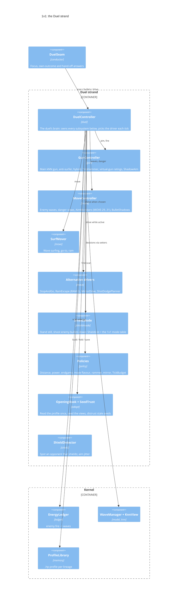

| Component | Role |
|---|---|
| `DuelController` | Holds the duel: the guns, the surf, waves and state logs, the ledger, the shield, the opening and seeds, the policies, the rammer and mirror responses. Knows nothing of melee; what a melee hands over arrives as a `Baton`. |
| `GunController` | Picks between the main kNN gun and the anti-surfer gun on their virtual ratings; the opening book can pick first (ADAPT-1). The per-opponent gun stack (TripHammer, free gun, undecayed) is a table slot. |
| `MoveController` | Keeps the enemy's waves and the danger views, learns from bullets that hit us, and (MOVE-29) mixes the views with simple-aim "members" whose weights follow how well each predicted real bullets. MOVE-30 also scores them on bullets our bullets intercepted. `BulletShadows` removes angles our own bullets protect (MOVE-1). |
| `SurfMover` | Turns danger into orders: three-option surf, go-to surfing, the orbit, the ram on a disabled enemy. |
| `StopAndGo`, `RamEscape`, `MirrorDrive`, `ShotDodgePlanner` | Drivers that replace the surf against specific kinds of opponent: stop-and-go picks from the table (POISON-2), the escape from a confirmed rammer (RAM-2, with RAM-5 scoring paths against its shots), the planned path against a mirror bot (MIR-1). |
| `ShieldMode` | For an opponent on the shield list: stand still and shoot its bullets down, with learned predictors, a shipped aim and an opening drive from the table, and an exit if the damage budget runs out (SHIELD-5, SHIELD-6). |
| Policies | Distance controller (DIST-1), power (POW), endgame finish and ram (END-1, END-2), movement flavour (MOVE-2), tick budget levels (TIME-1, TIME-2), rammer and mirror recognition. They see no `BotInput` (DIAL-2) and act through setters. |
| `OpeningBook`, `SeedTrust` | At first scan, read the `.hp` profile once: gun tier, movement tier, starting distance, seeds replayed at half weight; seeds fade when live data disagrees (RES-4). |

### How the Duel chooses its driver each tick

The order inside `DuelController.drive` is the 1v1 mode table made concrete:

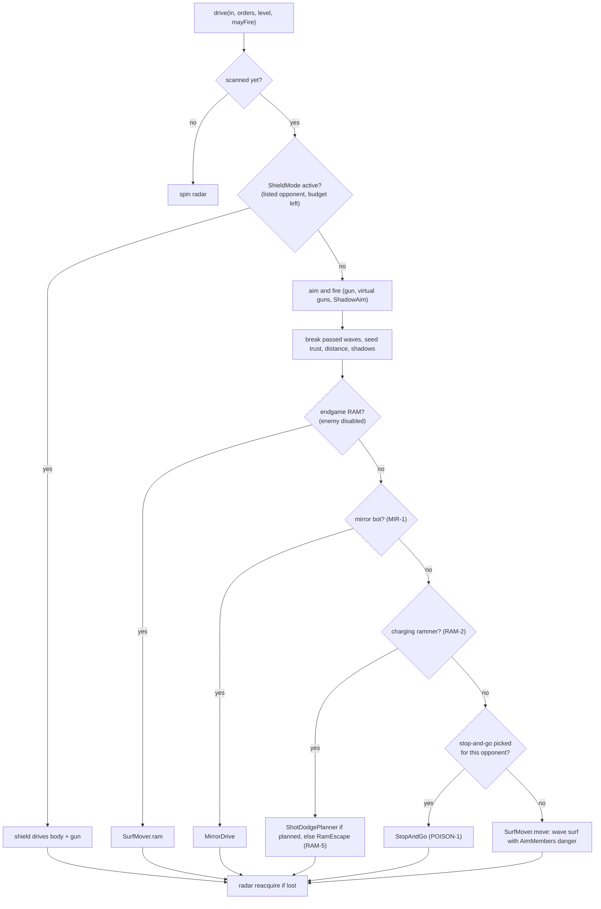

### What the first scan decides

The opponent's name arrives with the first scan. `DuelController.announce` then fixes the whole
per-opponent setup for the battle, before the first order of that tick:

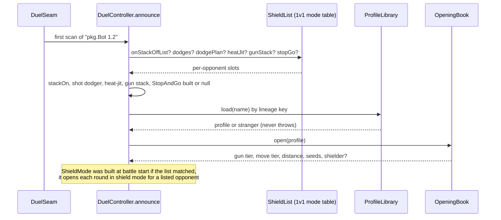

### Code level: the Duel's main classes

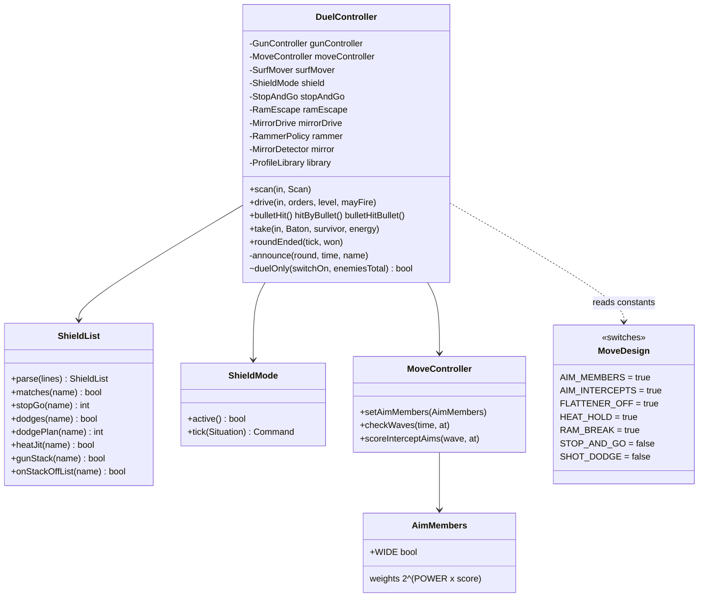

### 1v1 memory

The `.hp` profile is the duel's alone. It is loaded at the first scan, folded at every round's
end, saved while alive and at battle end (MEM-1 to MEM-3), written with a temporary copy so a
kill at any byte leaves a loadable file (RES-3), and evicted least-recently-fought first near the
quota (MEM-5). Only a Duel-charter battle writes it (SHELF-3). A melee reads the survivor's `.hp`
read-only for the hand-off.

## The melee style

### Melee components

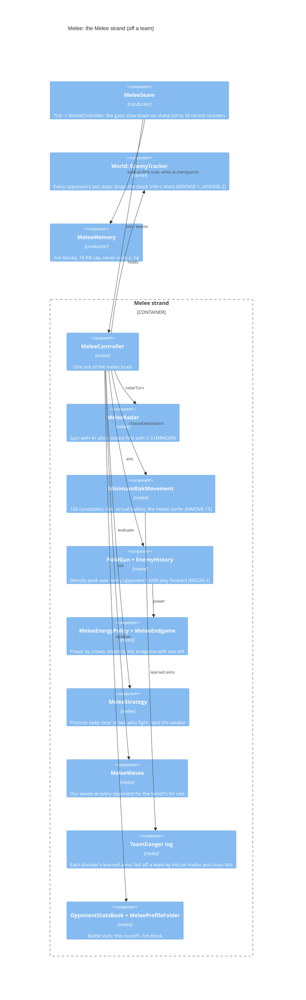

| Component | Role |
|---|---|
| World (`EnemyTracker`) | Kernel. The one picture of the field: position, heading, velocity, energy, scan tick of every opponent. Drops a robot at its death on the same tick; drops a ghost when the engine's count says someone died unheard. Turns unexplained energy drops into `EnemyShot`s with a timing window. The conductor feeds it before any role, whichever role drives. |
| `MeleeRadar` | Spin while four or more live; with two or three, turn to the one scanned longest ago, rescanning a weak target the gun wants. |
| `MinimumRiskMovement` | Scores 160 points on rings round Hadur: each opponent's energy over distance squared (doubled where Hadur would be its closest robot), virtual bullets for every inferred shot, walls, centre, own path, a hashed noise field, the posture. With the melee surfer on (MMOVE-15) shots are weighed by who else is nearer the shooter, a shooter with enough learned hits is dodged at its learned aims, and the least risky few candidates are re-ranked by the waves their drive would cross. |
| `FieldGun` + `EnemyHistory` | No single target. Each fresh opponent's battle-long kd-tree plays its likely movement forward; the gun fires at the peak of all solutions, weighted by distance, weakness and threat. |
| `MeleeEnergyPolicy`, `MeleeEndgame` | Exact kill power, Ogi's crowd power (MGUN-13) with power 3 out to 300 px (MGUN-16), the duel's table with two or fewer left; MEND-3 doubles the closest-robot factor with two left. |
| `MeleeStrategy` | The posture; it shapes where Hadur goes and never whether or how hard it fires (MGUN-5). |
| `MeleeMemory` | Conductor-owned because it joins melee blocks to memory's lineage keys and the store. One `.hm` file per opponent beside its `.hp`, under a 16 KB cap, skipped rather than costing a 1v1 profile its room. |

### Melee tick and the hand-off to the duel

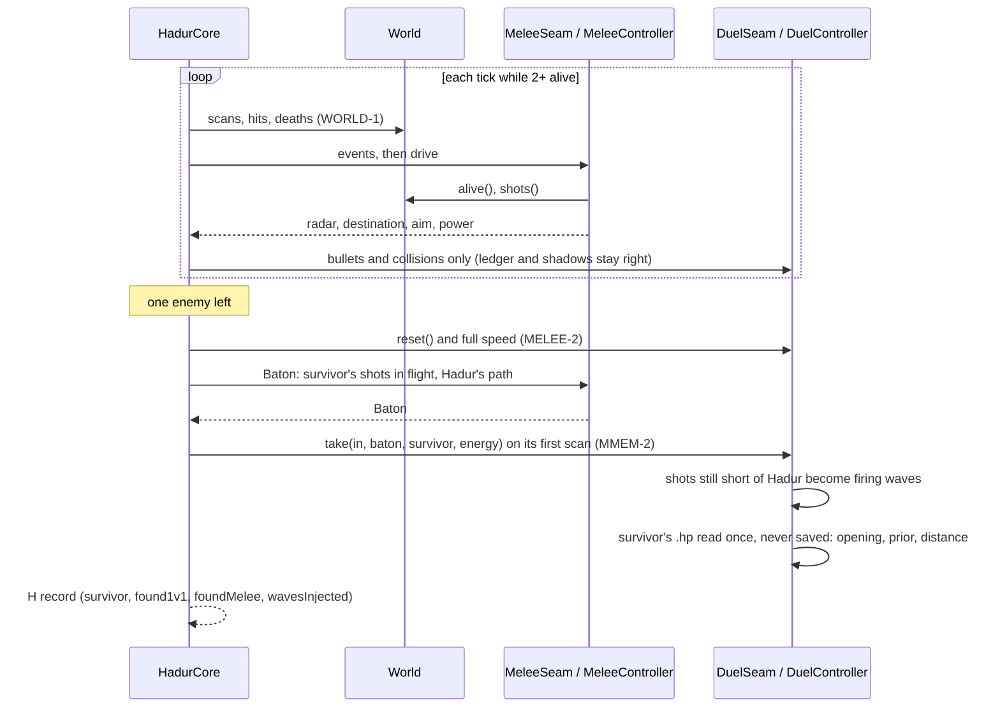

Melee-charter duels play without the 1v1 per-opponent table: `ShieldList.NONE` is passed to the
duel outside a Duel charter, and every duel-only switch is gated by `duelOnly(switch, enemiesTotal)`
on the battle's starting enemy count.

## The team style

### Team components

On a team, each member is the melee brain plus the conductor's `TeamLink` round it, with the
team's tactics inside the melee strand behind `onTeam`.

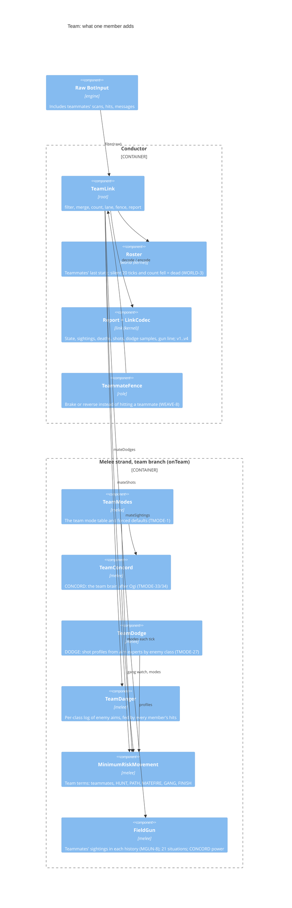

| Component | Role |
|---|---|
| `TeamLink.filter` | Takes every event that names a teammate out of what the roles see (WORLD-7): no brain targets or counts a teammate. Our bullet that ends on a teammate reaches the role as a miss (WORLD-6). Gives the roles the WORLD-8 enemy count. |
| Report merge | Each teammate's report (built on its last tick, delivered on ours) is merged once, oldest first, keeping the newer sighting (WORLD-4). Sightings go to the World and to the field gun's histories before our own scans of the tick (MGUN-8). |
| Fire lane | `laneClear` withholds the fire permission while a teammate is nearer than the enemy on the gun's line and within a robot's width of it (WEAVE-9, the narrow lane; `NARROW_LANE = true`). Wide and predicted lanes stay as ablations or per-team picks (LANEP, LANEB). The Guard's safe orders hold fire on a team (WEAVE-5). |
| `TeammateFence` | Simulates the drive a few ticks ahead and swaps it for a brake or reversal that stays clear of teammates, whichever role drives. |
| Report out | While a teammate lives, every completed tick's orders carry our `Report` (LINK-4). |
| `TeamModes` | Per tick, the modes against this team: the first living enemy whose class the table names, else the default set. |
| `TeamConcord` | The team brain: risk counts every robot nearer an enemy than the point, FINISH plays, GANG switches itself on once 4% of 200+ member-turns show ganging, the gun pools situations by class and fires at most 1.9 beyond 200 px unless reading that class well. |
| `TeamDodge` | Each detected shot profiled once from simple aims and the team's learned aims, weighted by each expert's loss against that enemy class; destinations re-ranked by profiles and teammates' bullets crossed (with OWN_FIRE). |

### Team tick: shared eyes one tick late

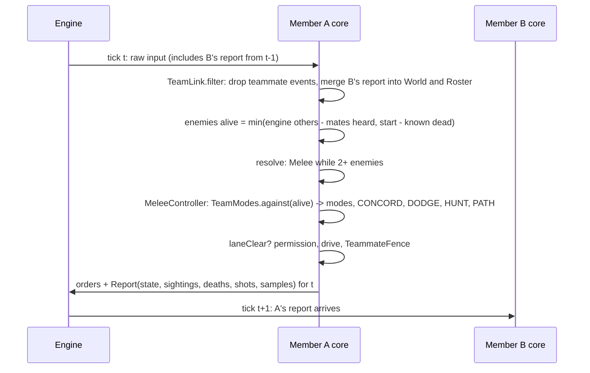

When enemies fall to one, the member hands over to the Duel as in melee, but with
`ShieldList.NONE` and every duel-only switch off, so a team's last duel is the plain duel.

## Switches and mode tables

Hadur's behaviour is chosen at four tiers. From slowest to fastest:

| Tier | What | Where it lives | Who changes it | When it takes effect |
|---|---|---|---|---|
| 1. Compile-time switches | `static final boolean` flags (and a few constants) per feature | design classes and the feature's own class | a master PR after a bench gate; an ablation build for a test | the build |
| 2. Per-opponent mode tables | named opponents get a non-default play | 1v1: `ShieldListData`, `ShieldTableData`, `StackListData` in the robot jar. Team: `TeamModes.TABLE` | a master PR from a bench screen; table ablations fill them for a run | 1v1: first scan of the battle. Team: every tick |
| 3. Charter and role gates | which brains exist and which drives | `Charter`, `RoleResolver`, `duelOnly`, `onTeam` | fixed by the design | tick 0 and every tick |
| 4. Runtime adaptation | learned choices inside a battle | opening book tiers, move flavour, seed trust, virtual-gun ratings, AimMembers weights, TickBudget levels, ShieldMode exits, CONCORD's gang watch | the battle's own evidence | as evidence arrives |

### Tier 1: how a compile-time switch works

A switch is a `public static final boolean` with a requirement ID in its Javadoc, for example
`MoveDesign.AIM_MEMBERS` (MOVE-29) or `TeamModes.FORCE_CONCORD` (TMODE-34).

- **Why constants.** The core may hold no mutable static state and do no I/O (ArchUnit, RES-6), and
  the sandbox will not let the robot read a config file from its jar. A `final` constant is folded
  by `javac`, so a switch that is off costs nothing at run time and cannot drift between ticks, and
  replays stay deterministic.
- **Gating by style.** A duel switch is read through `DuelController.duelOnly(switch, enemiesTotal)`,
  which is false whenever the battle started with more than one enemy. A melee switch is read only
  where `!onTeam`, and a team switch only where `onTeam`, so each switch acts in exactly one style.
- **Ablation builds.** `hadur-bench/build-ablation.sh NAME[,NAME...]` checks out the source (or
  `--ref`) into a temporary worktree, edits the switch's source line with `edit()`, which fails
  unless the text occurs exactly once, appends the ablation's suffix to the version
  (3.20 + `tmnoconcord` = `3.20ncn`), builds, checks the jar's `robot.version`, and drops
  `bisect/hadur117.Hadur_<v><suffix>.jar` (and the team jar) for the bench. About 170 ablations
  exist: switch flips, table fills from a file, and A/A copies (`aa`, `bb`) that change nothing
  but the name so a run can price its own noise.
- **Cards.** A bench card (`hadur-bench/plans/*.queue`) builds its arms, runs each against a
  baseline on shared fresh seeds with an A/A control, applies declared `stop:` rules, gates the
  result (for example "+0.30 APS with the 95% low end above zero"), and opens a results PR.
- **Shipping.** A switch that passes is flipped on master in its own PR, with its requirement
  updated, only its owner re-pinned, and only its own style's replay fixtures re-recorded. A
  release then carries it once 1v1, team and melee are all ready.

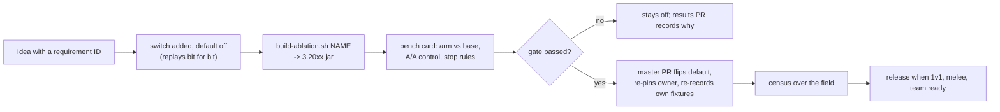

### The switch catalogue (master, 2026-10-31)

**Duel (1v1 only, through `duelOnly`)**

| Switch | Req | State | What it does |
|---|---|---|---|
| `MoveDesign.AIM_MEMBERS` | MOVE-29 | **on** (3.20) | The surf's danger mixes the views with simple-aim members weighted by their record on real bullets |
| `AimMembers.WIDE` | MOVE-31 | **on**, master only | 18 aims (six simple aims at three lags) instead of three |
| `MoveDesign.AIM_INTERCEPTS` | MOVE-30 | **on**, master only | Intercepted enemy bullets also score the members |
| `MoveDesign.FLATTENER_OFF` | MOVE-24 | **on** | The flattener never switches on |
| `MoveDesign.HEAT_HOLD` | MOVE-11 | **on** | Hold the provisional gun-heat wave |
| `MoveDesign.RAM_BREAK` | RAM-5 | **on** (3.19) | The rammer escape scores paths against the rammer's shots in flight |
| `GunController.SHADOW_AIM` | GUN-7 | **on** | Shadow aim, left out once the matchup is won |
| `ShieldDesign.SHIPPED` | SHIELD-8..16 | `prior,wall,hold,learn,mode,stay` | Which shield-mode parts run; `still` (SHIELD-20) is off and waits for a PC card |
| `MoveDesign.STOP_AND_GO` | POISON-2 | off | Forces stop-and-go on everyone; per-opponent picks come from the table instead |
| `MoveDesign.SHOT_DODGE`, `SHOT_DODGE_PLAN` | DODGE-3..6 | off | Force the simple-aim dodge or planner on everyone; table slots exist |
| `MoveDesign.STACK_LIST` | MOVE-23 | off | Makes `StackListData` (197 top robots) switch the stop-start stack off; inert while off |
| `GunDesign.TRIPHAMMER`, `FREE_GUN`, `UNDECAYED` | GUN-8..11 | off | The gun stack; per-opponent `gun-stack:` slot, empty |
| `MoveDesign.PROTEAN`, `GUN_SPLIT`, `HEAT_WAVE`, `REPLICATOR`, `MIMICS`, `ESCAPE_ROOM`, `STOP_POINT_SURF`, `POINT_KERNEL`, `KEEP_SECOND_WAVE`, `GUN_GATE`, `DISTANCING_TO_ENEMY`, `HIT_CLEARS_CACHE`, `BULLET_HIT_BULLET_LOG`, `RAM_HEAT`, `AIM_MIX` | MOVE-12..28 | off | Tried and not shipped, or superseded (the core surf rebuild is closed) |
| `MoveDesign.AES_RECORD`, `ORACLE_RECORD` | AES-1, ORACLE-1 | off | Telemetry recorders for the bench's studies |
| `PowerDesign.PRESSURE*` | POW | off | Pressure power variants |

**Melee (off a team only)**

| Switch | Req | State | What it does |
|---|---|---|---|
| `MinimumRiskMovement.MELEE_SURF` | MMOVE-15 | **on**, master only (3.21) | The melee surfer: crowd-weighted shots, learned aims, wave re-rank |
| `MeleeController.MELEE_CROSS` | MMOVE-19 | **on**, master only (3.21) | Learn a shooter's aim from its hits on others |
| `MeleeEnergyPolicy.CROWD_OGI` | MGUN-13 | **on** | Ogi's crowd power, 3 up close |
| `MeleeEnergyPolicy.OGI_WIDE` | MGUN-16 | **on** (3.19) | Power 3 out to 300 px |
| `MeleeEndgame.THREE_FAR` | MEND-3 | **on** | With two left, closest-robot factor 4 |
| `MELEE_AIMED`, `HOPS`, `HEAT`, `CLOSER`, `MIX`, `PATH_DANGER`, `SHADE`, `BULLET_SHADE`, `SEARCH`, `DAMAGE_MEMORY`, `FULL_LATERAL` | MMOVE-11..23 | off | Crowd movement ideas (ScalarR, Diamond) benched and not shipped |
| `FieldGun.EXPERTS`, `HIT_TARGET`, `FLAT_DISTANCE`, `SOFT_MATCH`, `DECAP`; `EnemyHistory.CROWD` | MGUN-11..21 | off | Field gun variants |
| `MeleeEnergyPolicy.AVG_POWER`, `CROWD_FLOOR`, `OGI_LOW`, `OGI_TWO`, `SCAL_POWER`; `MeleeEndgame.THREE_POWER`, `THREE_RING` | MGUN, MEND | off | Power and endgame variants |
| `MeleeRadar.TEAM_LOOK` | MRADAR-3 | off | Team radar look |

**Team (only while a teammate lives)**

| Switch | Req | State | What it does |
|---|---|---|---|
| `TeamModes.FORCE_MATEFIRE` | TMODE-9, -12 | **on** | Teammates' bullets count as danger |
| `TeamModes.FORCE_HUNT` | TMODE-13, -14 | **on** | Packs of two or three per enemy at 350 px |
| `TeamModes.FORCE_PATH` | TMODE-25, -28 | **on** | Check each drive against teammates' bullets |
| `TeamModes.FORCE_DODGE` + `TeamDodge.OWN_FIRE` | TMODE-27, -29, -30 | **on** | Ogi's dodge as one piece, own fire kept |
| `TeamModes.FORCE_CONCORD` | TMODE-33, -34 | **on**, master only (2026-10-31) | The team brain on every team; confirm card `pc-team-concord2` |
| `TeamConcord.MOVE`, `GUN`, `RISK`, `POWER`, `POOL` | TMODE-33 | **on** | CONCORD's parts; `RADAR` and `NO_HUNT` off |
| `TeamLink.NARROW_LANE` | WEAVE-9 | **on** | Ogi's narrow fire lane; `NARROW_PREDICT`, `NARROW_BEYOND` off |
| other `FORCE_*` (SOFT, GANG, FINISH, LEARN, PACK, SCREEN, POOL, DISABLED, REAR, WAVES, LINES, GUNLINE, LEAD, SWIFT) | TMODE-2..32 | off | Only through the table, or for an ablation |
| `TeamDanger.LEARNED`, `NEAREST`; `TeamDodge.RANK_BULLETS` | MMOVE-9, -10 | off | Older learned-danger switches |
| `RoleResolver.TEAM_BUILT` | ROLE-3 | off | There is no Team role; members play Melee then Duel |

### Tier 2: the 1v1 mode table

The 1v1 table is per opponent, PC-trained and census-gated: only per-opponent picks have shown
live gains. It ships as three classes in the robot jar, because the sandbox refuses a robot the
read of its own jar's resources but lets classes load.

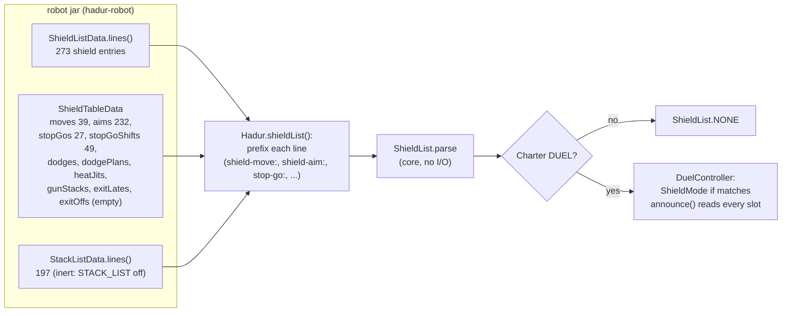

| Table slot | Line prefix | Req | Entries | Effect on a matched opponent |
|---|---|---|---|---|
| shield list | (none) | SHIELD-5 | 273 | Each round opens in shield mode; SHIELD-6 leaves it for the battle if the damage would hold our share under 85% |
| `moves()` | `shield-move:` | SHIELD-17 | 39 | Saguaro's moving shield opening drive |
| `aims()` | `shield-aim:` | SHIELD-18 | 232 | The shield starts with this predictor and offset already learned |
| `stopGos()` | `stop-go:` | POISON-2 | 27 | Stop-and-go, reverse crawl one tick early |
| `stopGoShifts()` | `stop-go2:` | POISON-2, BENCH-126 | 49 | Stop-and-go, two ticks early |
| `dodges()`, `dodgePlans()` | `shot-dodge:`, `shot-dodge2:` | DODGE-3, DODGE-4 | 0 | Simple-aim dodge; shot-dodge planner with a shipped expert |
| `heatJits()` | `heat-jit:` | MOVE-28 | 0 | Stop-and-start surf |
| `gunStacks()` | `gun-stack:` | GUN-11 | 0 | TripHammer gun stack (never for a shield opponent) |
| `exitLates()`, `exitOffs()` | `shield-exit4:`, `shield-exit0:` | SHIELD-19 | 0 | Later or no damage exit from shield mode |
| `StackListData` | `stack-off:` | MOVE-23 | 197 | Stop-start stack off, only with `STACK_LIST` on |

Matching is exact: `pkg.Bot 1.2` matches that version only, `pkg.Bot` every version, never a prefix.
Entries arrive from bench screens: the table ablations (`smovelist`, `saimlist`, `sgolist`,
`sgo2list`, `sdodgelist`, `sdplanlist`, `hjlist`, `gslist`, `sx4list`, `sx0list`, `slistadd`,
`slistdrop`) fill a slot from a pick file for an arm; a pick that passes is pasted into the class.

### Tier 2: the team mode table

`TeamModes.TABLE` maps an enemy member's class (name without version or `(n)` marker) to a set
of modes. Each tick `TeamModes.against(alive)` returns the entry of the first living enemy the
table names, or the default set built from the `FORCE_*` switches.

| Enemy class | Modes | Evidence |
|---|---|---|
| default (every other team) | MATEFIRE, HUNT, PATH, DODGE, CONCORD | TMODE-12, -14, -28, -30, -34 |
| `gh.nano.GrofGroupMember` | MATEFIRE, HUNT, OWN, LINEAR, PATH, DODGE, CONCORD | pc-team-counters PR #370, +2.5 |
| `myl.micro.Troodon`, `TroodonDroid` | MATEFIRE, HUNT, OWN, HEADON, PATH, DODGE, CONCORD | PR #370, +4.7 |
| `ustimaw.Nightmare`, `NigitmareDroid` | MATEFIRE, HUNT, PATH, CONCORD (no DODGE) | pc-team-nododge PR #465, +3.9 |
| `mn.nano.perceptual.Impact` | MATEFIRE, HUNT, PATH, CONCORD (no DODGE) | PR #465, +3.1 |

CONCORD then rewrites the set it is given (`TeamConcord.modes`): HUNT's range variants stand down,
FINISH plays, and GANG joins once the battle shows ganging. Team ablations (`tmXXX`) force a mode
into the default and append it to every named entry, so one bench run scores a mode against all
46 teams; `tmnoX` removes it.

### Tier 4: what adapts inside a battle

| Mechanism | Style | Evidence it reads | What it changes |
|---|---|---|---|
| `OpeningBook` tiers (DIAL-1) | 1v1 | `.hp` profile, named only within a 3-point margin | first gun, flattener, surf prior, starting distance, power tier |
| `SeedTrust` (RES-4) | 1v1 | live hit rates against the profile's | seed weight fades to 0 in 20 waves |
| Virtual-gun ratings | 1v1 | our virtual bullets | main vs anti-surfer gun |
| `AimMembers` weights | 1v1 | log-probability of each real bullet | how much each simple aim shapes the danger |
| `DistancePolicy`, `PowerPolicy`, `Endgame` | 1v1 | rolling hit windows, energies, gun heat | distance in or out 25 px, full power, finish, ram |
| `MoveFlavour` (MOVE-2) | 1v1 | their hit rate vs the profile | flattener, go-to, band out |
| `RammerPolicy`, `MirrorDetector` | 1v1 | closing speed, mirrored positions | escape or mirror drive |
| `ShieldMode` exits (SHIELD-6) | 1v1 | enemy damage | leave shield for the battle |
| `TickBudget` (TIME-1, TIME-2) | all | `TickTime`, skipped turns | waves surfed, k share, virtual guns |
| `TeamDanger` / `TeamDodge` experts | melee, team | hits on Hadur (and teammates) | learned aims, expert weights |
| `TeamConcord` gang watch | team | member-turns with 2+ enemies within 250 px | GANG on for the battle |

## Shared state

| State | Owner | Lifetime | Read by |
|---|---|---|---|
| `HadurCore`, `Guard` (adapter statics) | adapter | battle | everything |
| `Charter`, sentry names | conductor | battle | resolver |
| Veto, latch, focus, dead this round | conductor | round | resolver, seams |
| World (`EnemyTracker`) | kernel, fed by conductor | round | melee brain, TeamLink |
| `Roster`, link counters | kernel, TeamLink | battle | TeamLink, melee team branch |
| Duel kNN views, gun ratings, hit windows, AimMembers scores, distance | duel | battle | duel |
| Waves, state logs, ledger | duel | round (cleared by recovery) | duel |
| `EnemyHistory` trees, `OpponentStatsBook`, `TeamDanger` log, `TeamConcord` | melee | battle | melee |
| `RoundStats` (R record), M record counters | kernel / conductor | round | telemetry |
| `.hp` profiles, `battles.hc` | duel shelf | persistent | duel; melee hand-off (read-only) |
| `.hm` blocks | melee shelf | persistent | melee |
| health record | conductor | persistent | bench |

Between team members nothing is shared in memory; the only shared state is what a `Report`
carries and the data directory, which only the leader writes.

## The isolation rule

**Team and melee changes must never affect 1v1.** Eight mechanisms hold it, from the structure of
the code to the release process:

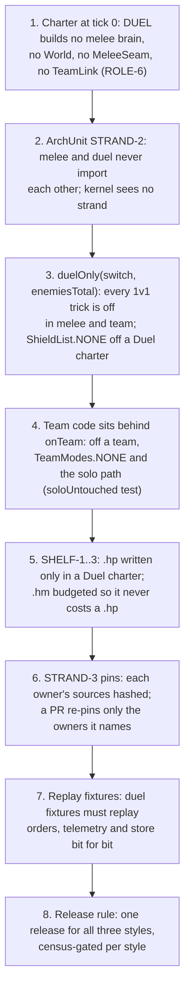

1. **The charter.** A 1v1 is a `DUEL` charter, so none of the melee or team objects exist: there is
   no code path from a duel tick into them.
2. **The layering.** `StrandOwnershipTest` and `ArchitectureTest` fail the build if a melee class
   imports a duel class, or the other way round, or if the kernel imports a strand.
3. **Duel-only gates.** Even inside the shared Duel brain (which also ends every melee and team
   round), every per-opponent trick and duel switch is `duelOnly`, and the 1v1 table is
   `ShieldList.NONE` outside a Duel charter. So tuning 1v1 also never shifts melee endgames.
4. **The team branch.** Every team mode, CONCORD, DODGE and the team gun settings are read only with
   a living teammate. Melee switches are read only off a team.
5. **The shelves.** The Archive gates writes by file suffix and charter.
6. **The pins.** `pins/<owner>.sha256` hash each owner's sources. A team PR shows only `melee` (and
   perhaps `conductor`) pins moving; a moved `duel` or `kernel` pin is a review flag.
   `DuelIdentityTest` additionally pins the nine packages the duel is made of.
7. **The replays.** Eleven-plus fixtures (six duels, a warm duel, a duress duel, a ten-robot melee, a
   sentry melee, a hand-off melee, two team members) replay to identical orders, telemetry and store.
   A team or melee change re-records only its own fixtures; the duel fixtures must pass untouched.
8. **The release rule.** A release ships when 1v1, team and melee are each ready, each census-gated.

**Where isolation is thinnest.** The kernel (`model`, `physics`, `knn`, `world`, `memory`, `link`)
and the conductor are shared by all three styles, so an edit there can move 1v1 play. The rule
for such a change is that the duel replay fixtures replay bit for bit; if they cannot, it is a
duel change and needs a 1v1 bench gate of its own. The Duel brain also plays the last duel of every
melee and team round, so a duel change does move melee and team scores slightly; that direction
is allowed.

## Faults and determinism

- **Guard (RES-1).** Catches anything, `Error`s included, and a null result. Safe orders: keep
  moving, body side-on to the last bearing, radar on it, hold fire. A `FAULT` line once a round.
  The next scan asks the core to `recover()`: transient state goes, learning stays.
- **Melee faults (GATE-4).** A throw in the melee brain vetoes Melee for the round; the Duel drives.
- **Determinism (CORE-2).** No `robocode.*`, no randomness, threads, reflection, I/O, clock or
  mutable statics in the core (ArchUnit). Tick time arrives as an event. Noise fields are hashes.
- **Bounded growth (RES-2).** Logs capped at 5,000 states, views at 50,000 points, dead names at 64,
  table entries capped.

## Where to change what

| To change | Touch | Re-pin | Fixtures that must still replay bit for bit |
|---|---|---|---|
| 1v1 play against one opponent | a table slot in `ShieldTableData` / `ShieldListData` | none (robot module) | all (the opponent is not a fixture opponent) |
| 1v1 play for everyone | a `duel`, `gun`, `move`, `policy` or `shieldmode` switch | `duel` | melee and team; re-record duel |
| Melee crowd play | a `melee` switch read `!onTeam` | `melee` | duel and team |
| Team play | `TeamModes`, `TeamConcord`, `TeamDodge`, `TeamLink` | `melee`, `conductor` | duel and melee |
| Shared engine model | `model`, `physics`, `knn`, `world` | `kernel` | all, or treat as a duel change |
| The tick, roles, fences | root, `role` | `conductor` | all |

## Glossary

- **APS**: average percentage score, the rumble's ranking measure.
- **Arm**: one build in a bench run; **A/A** an arm identical to the base under another name.
- **Card**: a `plans/*.queue` bench plan with steps, stop rules and a gate.
- **Charter**: the battle's kind, fixed at tick 0.
- **Census**: a bench run over the whole field to project a release's rank.
- **Shelf**: a brain's files in the data directory.
- **Strand**: an owner of behaviour for one style (Duel, Melee, Team).
