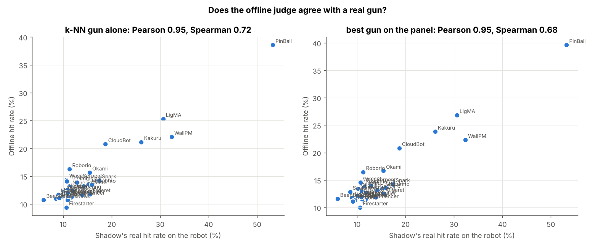
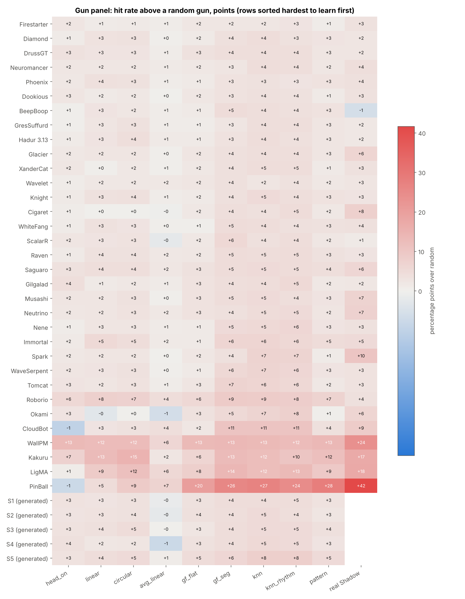
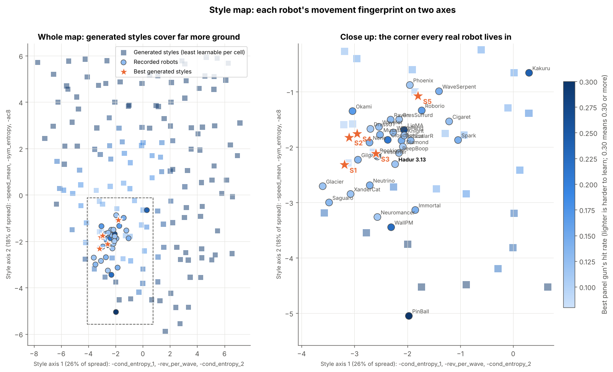
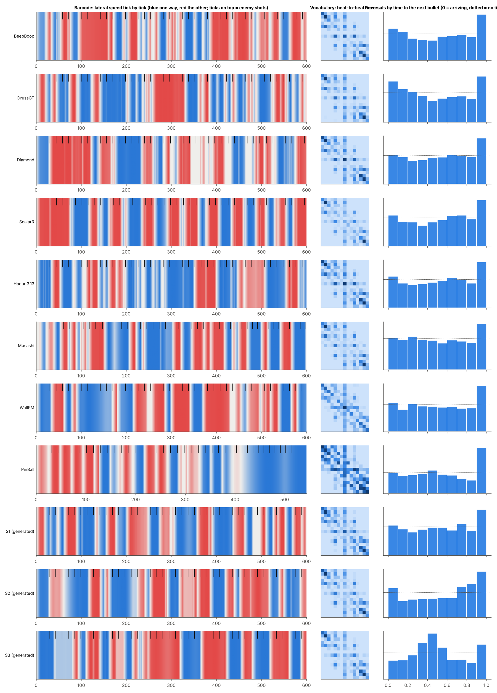

# Style lab: movement as pattern and design, outside Robocode

2026-10-17. Leigh asked whether we could trace movement and judge it outside Robocode, as pure
pattern and design matching, in search of a movement style of our own. This is the first pass:
the tools in `data/tools/style_lab/`, traces of 33 robots, and what they show.

## What the lab is

| Piece | File | What it does |
|---|---|---|
| Trace | `movetrace.py` | A battle as arrays: both robots' x, y, heading, speed, energy per tick, and the shooter's shots. Read from the bench's `truth.log.gz`, or written by the generator. `lab.py export` writes them as CSV. |
| Fingerprint | `fingerprint.py` | 24 numbers per robot with no gun in the loop: the move vocabulary (15 symbols of lateral and advancing speed on a 4-tick beat, their entropy and compressibility), dwell between reversals, where reversals fall against the enemy's gun cycle, speed, distance, walls, rhythm. |
| Gun panel (the judge) | `guns.py` | Nine offline guns fire virtual bullets at every tick the real shooter fired: head-on, linear, circular, averaged linear, flat and segmented guess factors, k-NN (seven features), k-NN plus the last dwell, and a symbolic pattern matcher. Learnability is the best gun's hit rate. |
| Generator | `generator.py` | A movement written as 20 parameters (distance and how hard it is held, a reversal clock, coupling to enemy shots, stops, slow segments, a wobble, wall policy, a regime switch), run in pure Python with Robocode's movement rules against a shooter that fires like Shadow. Open loop: it knows when the enemy fired, never where the bullet went. |
| Search | `lab.py search/confirm/ablate` | MAP-Elites: the style map is cut into a 14x14 grid and each cell keeps the generated style the panel finds hardest to learn; the best are re-run on fresh seeds and taken apart. |

Recording: each subject was benched (cloud, Robocode 1.11.1, 35 rounds, 3 cold seeds) against
Shadow 3.83c, the strong gun every rival faces in `movemap-ladder.txt`. Sets
`hadur-bench/style-subjects.txt` and `style-shooter.txt`. The truth logs are archived in the
project folder as `style-lab/style-traces-shadow.tar.gz`.

```sh
# per subject (see style-subjects.txt), then:
python3 data/tools/style_lab/lab.py measure --work hadur-bench/work/style --out OUT
python3 data/tools/style_lab/lab.py search  --out OUT --evals 1600 --batch 200
python3 data/tools/style_lab/lab.py confirm --out OUT --top 14 --seeds 4
python3 data/tools/style_lab/lab.py ablate  --out OUT --seeds 8
python3 data/tools/style_lab/lab.py draw    --work hadur-bench/work/style --out OUT
python3 data/tools/test_style_lab.py
```

## The judge agrees with a real gun

The panel's k-NN gun tracks Shadow's real hit rate across the 33 robots with Pearson 0.95
(Spearman 0.72; 0.64 Pearson among the 29 robots Shadow hits under 20%).


The gap between the two is the part of a movement that is reaction rather than pattern: Shadow's
real bullets miss BeepBoop 4.8 points more often than the replayed pattern says they should
(real 5.9%, pattern 10.7%), Hadur 2.8 points (9.0% against 11.7%). The panel cannot see that part,
because it replays the path the robot took while dodging Shadow's bullets, not bullets aimed by
the panel.



## Every real robot lives in one corner



The map's axes are the first two principal components of the fingerprints of the 33 robots and
400 random generated styles. All 33 robots, from nanobots to the number one, sit in one corner of
it; the generated styles cover several times that area. The grey squares away from the corner are
generated styles the panel hits 30% of the time or more. **No region outside the corner was found
where the panel misses more often.** The 1,600 generated styles went everywhere, and the hardest
to learn (S1 to S4) came back to the corner, next to Glacier, Gilgalad, Firestarter and Hadur.

Hadur's nearest neighbours by fingerprint are Diamond and Knight (distance 1.8, the closest pair
on the map). Against the top five (BeepBoop, DrussGT, Diamond, ScalarR, Firestarter), Hadur
dwells longer between reversals (31.8 ticks against 25.8), reverses less per enemy shot (0.41
against 0.51), stands still more (10% of ticks against 6%) and spends less time near a wall (31%
against 46%). Hadur's consecutive dwells are the most alike of all 33 robots (correlation 0.36
between one dwell and the next), but a k-NN gun given the last dwell as an extra feature does not
hit Hadur more often (-0.8 points), so that rhythm is not a weakness.



## The best generated style, and what it needs

S1, confirmed on 8 fresh seeds: the panel's best gun hits it 11.7% of the time, 1.85 times a
random gun. That matches the masters' raw rate (Diamond 11.1, DrussGT 11.3, Hadur 11.7) without
seeing a bullet, but relative to a random gun it is a little easier (masters 1.6-1.7 times).

| S1 with this switched off | Best gun's hit rate | Times random |
|---|---|---|
| nothing (as found) | 11.7% ± 0.2 | 1.85 |
| regime switch | 14.5% ± 0.3 | 2.31 |
| slow wobble of the orbit angle | 12.3% ± 0.3 | 1.96 |
| reversing at walls | 20.7% ± 0.5 | 2.76 |
| reversals tied to enemy shots | 11.7% ± 0.4 | 1.87 |
| holding distance hard (gain 0.3) | 18.3% ± 0.5 | 2.55 |
| far range (450 instead of 640 asked, 480 held) | 20.2% ± 0.5 | 2.84 |
| regime switch and wobble | 15.3% ± 0.2 | 2.49 |
| all of it (a plain random orbit) | 17.1% ± 0.5 | 2.28 |

Three ingredients carry it: reversing when the wall-smoothing kicks in, holding a long range
hard, and the **regime switch**: on about 40% of enemy shots the reversal clock flips between two
dwell scales (about 27 ticks and 1.9 times that). Tying reversals to the shots adds nothing in the
open loop, since there is no bullet to dodge.

## What it means for a unique style

1. **The low-learnability region is already taken.** Movements as different as WallPM, PinBall
   and the top surfers are judged by the same panel, and the only place it misses is where the
   masters already are. Convergent evolution: twenty years of rumble selection found that corner.
   A pattern-level style that is both unique and hard to learn was not found in this space.
2. **The difference between masters is reaction, not pattern.** BeepBoop and Hadur have nearly the
   same pattern learnability (10.7% and 11.7% on k-NN) but Shadow hits BeepBoop 5.9% and Hadur
   9.0%. That agrees with the top-3 diagnosis: 78% of Hadur's damage lands inside its own surf
   plan, and the gap is how it ranks its options.
3. **One ingredient no real robot shows by design is the regime switch.** It cut the panel's hit
   rate by 2.8 points in the open loop. In Hadur it would be a per-wave switch between two surf
   temperaments (dwell scale, or the protean pick's temperature), a duel-only switch, off by
   default, through the 400-bot screen. MOVE-13's stop-and-start (+0.24 APS) may already be a
   partial, accidental version of it.

The natural next step is to close the loop: give the generator a surf (dodging the panel's own
bullets with the same danger model Hadur uses), so the lab can judge reaction as well as pattern
and a whole Hadur movement can be tuned offline before any battle.

## The regime switch on the PC (MOVE-17): closed

2026-10-18. The lab's regime switch was built into the surf as MOVE-17 (on each new enemy shot,
40% chance to flip between the free surf and a steady one that keeps its way round unless
reversing is 30% safer; patch `hadur-bench/plans/move17-regime.patch`) and screened on the PC:
3.13hjrg against 3.13hj, 400 opponents, 8 seeds. **-0.23 ± 0.16 pp score share, 153 opponents
better and 207 worse**; the weakest band is resolved negative (-0.16 ± 0.09). It fails the gate
and stays out of the stack. Report: `docs/bench/local/2026-10-18_pc-regime-hjrg.md`.

Why it does not carry over: the surf's reversals are chosen by danger, not by a clock, so holding
a reversal means taking the more dangerous option. The open-loop lab could not see that cost, which
is the reaction part it already said it was blind to. Pattern-level ideas from the lab need the
closed-loop lab (a generator with a surf) before they go to the PC.
