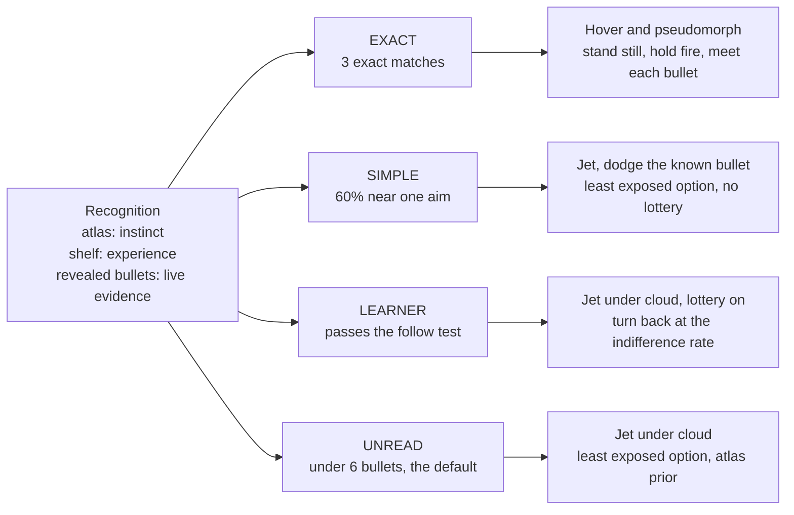
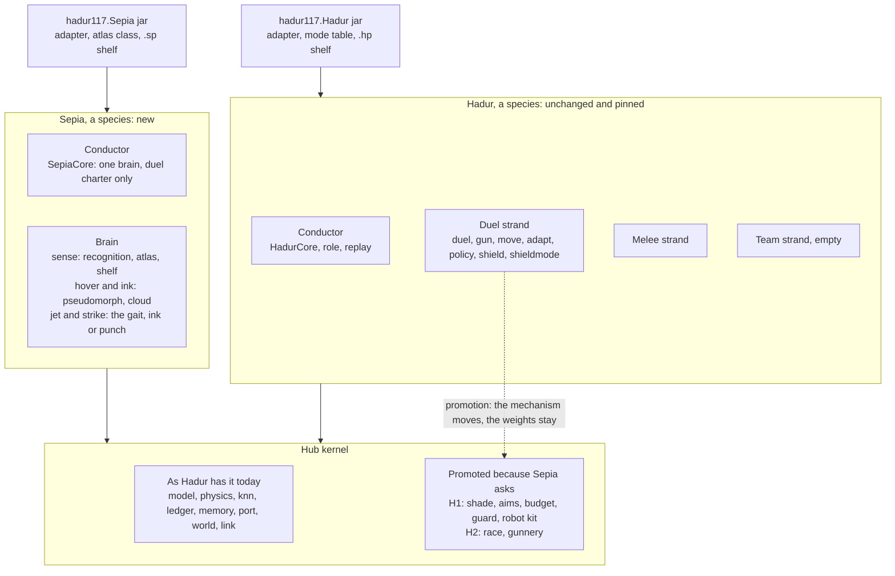
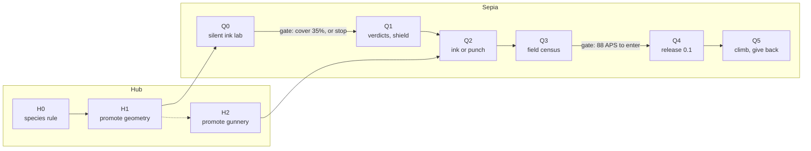

# Sepia — a bio-inspired defensive duelist on the Hadur hex core

2026-11-25. A proposal: nothing here is built. This is the repo's copy of the [live doc](https://claude.ai/artifact/HDZ7VhqC45eAewK5XtYR1U), whose diagrams are drawn here as tables and Mermaid. The model behind its figures is in [`data/tools/ink_model/`](../data/tools/ink_model/README.md), the APS estimate in [`data/tools/sepia_aps.py`](../data/tools/sepia_aps.py) with its read in [bench/local/2026-11-25_sepia-aps.md](bench/local/2026-11-25_sepia-aps.md), and the Q0 cards in [`hadur-bench/plans/cloud-ink-model.md`](../hadur-bench/plans/cloud-ink-model.md) and [`cloud-ink-lab.md`](../hadur-bench/plans/cloud-ink-lab.md).

## Summary

Sepia is a second 1v1 robot on Hadur's kernel that treats its gun as armour. It fires 0.1 "ink" bullets to shoot the enemy's bullets out of the air where its own body is about to be, and it moves so that those shots work. A model built on the engine's collision rule puts that cover at 48% of on-target bullets, against 1.5% to 2.6% for the way every top robot fires today.

**The data puts Sepia as designed at about 86.7 APS, 17th.** The range is 84.7 to 87.5, against Hadur's 93.44 and 10th place at 87.64. Most of the gap is hits taken while Sepia punches, not while it inks ([Estimated APS](#estimated-aps)).

- **The defence has three layers.** Against a gun that aims exactly, Sepia stands still and meets each bullet, as Hadur's shield does for 305 listed robots. Against the best of the other guns it runs under its own ink, and against the rest it punches from the same gait. Recognition picks between them from the bullets Sepia shoots down, not only the ones that hit it.
- **The movement is the new part.** Ink shades about 3 more points of the body for every degree between where it is fired and where the body lands. So Sepia commits one long run per enemy shot, inks from the start of it, and turns back at the rate that leaves a gun nothing better to aim at.
- **The counter-punch is a rule, not a mood.** Each shot is ink or a punch by its worth in score and energy. In the estimate that leaves ink ahead against about 20 robots, the best guns in the field, and punches everywhere else.
- **The hub is the lasting change.** Sepia is the second species on Hadur's kernel. It forces the first promotions out of the Duel strand without changing one Hadur order, and anything it proves can go back to Hadur behind a switch.
- **One cheap test decides it.** Stage Q0 measures cover from truth logs with a silent robot before any gun is built. Under 25% and the project stops there, with the hub work kept. The same card measures how often the jet cycle is hit with the ink off, the number the estimate turns on.

## Where Hadur stands, and why the hub needs a second organism

Hadur 3.24 is 2nd of 1,213 in the 1v1 RoboRumble at 93.44 APS, 1.50 behind BeepBoop, and its remaining gains arrive one named opponent at a time ([README](../README.md)). Three facts from the repo shape this design.

- **Being hit is the gap.** The field ledger (Hadur 3.21, traced 10 November) puts enemy bullets on Hadur 4.5% of the time against 2.8% for BeepBoop, and 8.0 damage a round against 5.8. Of 1,181 traced robots, 780 hit Hadur under 5% of the time, 331 hit 5 to 10% and 70 hit 10% or more. The 331 carry 1.57 of the ledger's 2.51 APS gap to BeepBoop ([field-ledger.tsv](../hadur-bench/field-ledger.tsv)).
- **The shield only works where aim is exact.** Hadur shields 305 listed robots by standing still and predicting a head-on bullet to within 1e-5 rad. The first prototype failed against XanderCat, Saguaro, Shadow and Raven, whose aim shifted once their bullets were met or the robot stepped aside ([bullet-shielding.md](bullet-shielding.md)).
- **Blanket unpredictability failed on the field.** The protean pick (MOVE-14, MOVE-15) cut a k-NN gun's damage by 6.0 a round in the lab. On 250 field robots it then lost 0.29 ± 0.27 points a robot to the stop-and-start, because every gun that was neither head-on nor linear was treated as a learner. It was retired in the 3.22 cleanup ([lab read](bench/local/2026-10-16_lab-protean-read.md), [field read](bench/local/2026-10-17_top3-s1c-split-read.md)).

**Sepia is a different bet on the same evidence.** Hadur dodges first and shields by list. Sepia covers first: its gun's first job is to blot out the part of each enemy wave its body will meet, and its movement is planned to make that cover wide.

**The hub has been waiting for a second customer.** The architecture evolution's promotion rule says a mechanism leaves a strand for the kernel only when a second strand needs it. No second megabot has ever asked. Sepia asks for six mechanisms in its first stage, which is what turns the kernel from Hadur's identity into a hub for robot design.

**Hadur's 1v1 stays sacred.** Sepia is its own class, jar, data directory, pins and requirement file. The hub stages move code without changing one Hadur order, proven by the 13 replay fixtures bit for bit.

## Design brief

Sepia is a 1v1 megabot that makes the opponent's bullets worthless first and takes its energy second. Each thing you asked for becomes a goal the bench can pass or fail.

| You asked for | In the arena | Measured by |
|---|---|---|
| Shoot down all enemy bullets | Every enemy wave gets a cover plan: an exact intercept where the aim is known, a wide shadow over the body's landing spot where it is not | Cover: the share of bullets that would have hit and were shot down first |
| Counter-punch as needed | Each shot is ink or punch, chosen by what it is worth in score and energy | Bullet damage a round, energy margin at round end |
| A movement Robocode does not have | The jet cycle: each run is planned so the ink fired early in it shades where it ends | Cover by sidestep, against the stream model |
| Incredibly hard to hit | Enemy hit rate and damage a round below Hadur's on the same seeds, class by class | Paired trace reads against Hadur 3.24 |
| The core becomes a hub | Sepia ships from Hadur's kernel with no Hadur order changed | Hadur's replay fixtures bit for bit, owners' pins |

**Identity.** Hadur presses when ahead and remembers every opponent. Sepia waits, covers and strikes when the strike is cheap. It is defensive by construction: its gun is armour before it is a weapon.

**Name.** *Sepia* is the genus of the common cuttlefish, *Sepia officinalis*, whose ink, freeze and jet this design borrows. The class is `hadur117.Sepia`. No robot on the live 1v1 list saved on 22 November carries the name.

**Non-goals.**

- Melee, team and the size-limited rumbles. Sepia's charter is the duel only.
- Replacing Hadur, or touching how Hadur plays.
- Copying a leader's code. The project rule stands: learn from it, be inspired by it.
- A first release that beats Hadur overall. Sepia is built to win the class Hadur is weakest in, then to trade proven parts with Hadur through the hub.

## What Robocode already has, and the gap

Every piece of Sepia's defence has been sighted in Robocode, but no robot plans its path and its defensive fire as one thing. That claim was checked against the RoboWiki and the rival sources the bench already holds.

| Technique | Who has it | What it does | Where it stops |
|---|---|---|---|
| Wave surfing on learned danger | Every top robot. Hadur: three-option surf, 18 simple-aim members, intercept views | Dodges where bullets have gone before | Against learning guns it sits near a floor: body width over escape range |
| Passive bullet shadows | Diamond, DrussGT, Hadur (MOVE-1, MOVE-43) | Scores the angles our attack bullets happen to block | 1.5% of the body's hit set in the stream model below |
| Shadow-aware aim | BeepBoop: about 20 candidate angles, about 40% of shots against a strong opponent not the likeliest hit. Hadur: GUN-7, at most 13 candidates within two half-widths of the gun's own angle | Bends an attack shot to shade the current plan | 2.6% in the model for a GUN-7-like bend of up to 0.9 half-widths. Timing and power are never chosen for shadows |
| Bullet shielding | EnergyDome, DrussGT, XanderCat, Saguaro, Nullstride (298 names), BeepBoop, Hadur (305 names) | Stands still, predicts a head-on bullet, meets it mid-air | Needs the heading to about 1e-5 rad. Aim jitter beats it, as Hadur's own SHIELD-2 does |
| Active bullet shadowing | [MoxieBot](https://www.cse.chalmers.se/~bergert/robowiki-mirror/RoboWiki/robowiki.net/wiki/MoxieBot.html), 2011 | Picks a spot, fires one 0.1 bullet to meet a bullet aimed at it, moves there | One thin line per wave: 36.01 APS. Its author found the shadows usually narrower than the robot |
| Random pick among options | Hadur's protean pick (retired), BeepBoop's path end speed | Hides the choice from a learning gun | Costs against simple and statistical guns. Lost on the field when the gun was misread |

Sources: RoboWiki on [bullet shadows](https://www.cse.chalmers.se/~bergert/robowiki-mirror/RoboWiki/robowiki.net/wiki/Bullet_Shadow), [bullet shielding](https://www.cse.chalmers.se/~bergert/robowiki-mirror/RoboWiki/robowiki.net/wiki/BulletShielding.html) and [BeepBoop](https://robowiki.net/wiki/BeepBoop/Understanding_BeepBoop); the repo's [top-3 movement study](top3-movement-study.md) and [bullet-shielding note](bullet-shielding.md).

**The gap.** Shielding protects a robot that stands still against a gun that aims exactly. Surfing protects a robot that moves against a gun that guesses. Nothing protects a moving robot against a bullet that is on target, and that bullet is where the 331 mid-class robots take their points.

**What is new in Sepia.** Three things, each checked against the list above.

1. **Ink is its own shot.** A 0.1 bullet fired on its own clock for cover alone, not an attack shot bent by a fraction of a body width.
2. **The path is planned for the ink.** Cover grows with the distance between where a shot is fired and where the body lands. Sepia drives so that distance is long.
3. **The mix is set by exposure.** How often Sepia turns back is the rate that leaves a gun nothing better to aim at, given how well each choice is covered.

MoxieBot is the honest precedent for the first two. It shaded one line with one bullet and reached 36 APS. Sepia shades the whole hit set of a moving body, across every wave in flight, with parts promoted from a robot that stands 2nd in the world.

## The biological model

Sepia copies the cuttlefish's order of defences, not its shape: read the predator, stay still while that works, ink and jet when it does not, and strike only when the strike is sure. Each row below is a reported behaviour and the mechanism it becomes.

| In the animal | What biologists report | In Sepia | Section |
|---|---|---|---|
| Defence chosen by predator | Cuttlefish gave different defences to seabass, bluefish and flounder over 25 trials ([Staudinger 2013](https://core.ac.uk/download/222883659.pdf)). Juveniles showed the deimatic display to fish that hunt by sight, not to crabs or dogfish ([Langridge 2007](https://sussex.figshare.com/articles/journal_contribution/Selective_signalling_by_cuttlefish_to_predators/23312885)) | Recognition: classify the enemy gun before choosing a defence | Recognition |
| Freeze | A frozen cuttlefish gives off a weaker bioelectric field. Sharks bit at the freeze-like field about half as often, 30% against 62% ([Bedore 2015](https://pmc.ncbi.nlm.nih.gov/articles/PMC4685776)) | Hover: stand still, so every gun's aim collapses to head-on | Pseudomorph |
| Ink as a decoy | A squid's pseudomorph holds the predator's strike while the animal leaves ([Hikidi](https://link.springer.com/article/10.1007/s10164-020-00640-8)[ 2020](https://link.springer.com/article/10.1007/s10164-020-00640-8), citing Wood 2010) | Pseudomorph: a bullet placed exactly on the enemy bullet's line | Pseudomorph |
| Ink as a smokescreen | Cuttlefish and octopus ink is read as a screen the animal retreats behind (the same paper, citing Hall 1956 and Staudinger 2013) | Cloud: a shadow wide enough to hide the body's landing spot | Cloud |
| Ink-blanch-jet | Colour change, ink, then irregular jetting that confounds the escape path ([Staudinger 2013](https://core.ac.uk/download/222883659.pdf), after Hanlon and Messenger) | The jet cycle: ink, then a committed run into its shade, with the turn-back rate set by exposure | Movement |
| A strike that waits | Cuttlefish use stereopsis to set their distance before the tentacles fire ([Feord 2020](https://pmc.ncbi.nlm.nih.gov/articles/PMC6949036)) | Strike: punch only when the hit chance is known and worth the energy | Counter-punch |

One measure comes from another animal. Moore and colleagues scored escape paths by their entropy and found the unpredictable jerboa the better evader ([Moore 2017](https://pmc.ncbi.nlm.nih.gov/articles/PMC5585173)). Sepia scores its own turn-back choices the same way, in bits, so unpredictability is a number on the bench and not a feeling.

**Where the analogy stops.** A Robocode tank has no jet. It tops out at 8 px a tick, gains 1 and sheds 2 a tick, and its body is a 36 px square that never turns. The biology supplies the order of operations and the decision rules. The geometry in the next sections supplies every number.

## The hit-probability budget

An enemy bullet hits when its aim lands on the body and nothing stops it on the way. That splits the chance into terms Sepia can move one at a time.

$$
P(\text{hit}) \;=\; \frac{W}{R}\; g\; (1 - c)
$$

- **W, the hit set.** The width of bearings that would hit the body as the wave passes: 37 px for a still body seen square-on, 51 px on a diagonal, about 52 px at full speed.
- **R, the landing range.** The stretch of spots the gun must spread its aim over: a little over 400 px at most at 450 px range against a power-2 bullet.
- **g, the gun's edge.** How much better than a flat guess the gun does: 1 against a mover it cannot read, far more against one it can.
- **c, cover.** The share of the hit set where one of our bullets meets theirs first.

Surfing works on g. Distance and wall room work on R. Hadur pulls those levers at a top-3 level already. Cover is the lever no top robot pulls hard. The stream model says it is large where it is used, and the APS estimate says where that is.

| Way of firing | Cover | Hit set left exposed | Attack shots per 100 ticks |
|---|---|---|---|
| All ink | 48.3% | 26.9 px of 52.4 | 0 |
| One ink per enemy shot, then attack | 41.4% | 30.7 px | 1.58 |
| Alternate ink and attack | 25.0% | 39.3 px | 4.04 |
| Attack shots bent for shadow, as GUN-7 does | 2.6% | 51.0 px | 7.17 |
| Attack only | 1.5% | 51.6 px | 7.17 |

*stream-duel model, 3 seeds of 2,400 ticks, 503 enemy waves · `data/tools/ink_model/e5.py`*

All-ink play leaves 26.9 px of a 52.4 px hit set exposed, against 51.6 px for attack-only play. The right-hand column is the price: gun time spent on cover is gun time not spent on damage, and the counter-punch section sets the mix.

| Change to the model | Cover |
|---|---|
| Enemy bullet power 1, 2, 3 | 44.9%, 48.3%, 51.2% |
| Range 350 px instead of 450 | 45.8% |
| Turning back on 10%, 30%, 50% of waves | 50.4%, 48.3%, 45.4% |
| Ink power tuned between 0.1 and 0.3 | 49.5% |
| Braking to a stop for each wave | 37.4% of a 43.7 px set: 27.5 px exposed, no better |
| Standing still | 16.5% |

**What the model is.** It applies the engine's collision order exactly as `BulletShadows` states it: a certain shadow counts 1, a possible one a half. A wave is known one tick after it is fired and aimed at from the second. Our bullet stops casting when it meets the enemy or leaves the field. The path is a random run with turn-backs, the planner is greedy, and the enemy fires on its gun heat.

**What it is not.** It is not the engine, and its enemy bullets are spread evenly over the hit set. Stage Q0 measures the same number from truth logs before anything else is built.

**What half is worth.** The prize is the mid and close classes: 401 robots where Hadur takes 16.3 and 25.5 damage a round against BeepBoop's 10.5 and 13.6. Halving on-target hits there would put damage taken at or under BeepBoop's, if the ink cost no punches. It does, and the APS estimate prices that: ink comes out ahead against about 20 robots, not 401.

## Recognition: which predator is this

Sepia picks its defence from how the enemy aims, and it learns that from the bullets it shoots down as well as the ones that hit it.

**Evidence.** Three sources, each already in the kernel or promoted to it by the hub.

- **Waves.** The energy ledger gives the fire tick, source and power of every enemy shot (WAVE-1, WAVE-2).
- **Revealed headings.** A bullet that hits Sepia, or meets one of Sepia's, shows its exact heading.
- **Simple aims.** `physics.SimpleAims` says where six simple aims at three lags would have sent that bullet.

Hadur learns from intercepts too (MOVE-30, MOVE-52), but an attack gun intercepts little. With cloud cover on, about half of the on-target bullets are revealed without a hit, so the verdict arrives sooner and costs less.

**Verdicts.** The first rule that fits wins, and every verdict carries its count and margin (DIAL-1).

| Verdict | Rule | Defence | In the field |
|---|---|---|---|
| EXACT | One aim predicts three revealed bullets to 1e-5 rad, or the atlas ships the aim | Hover and pseudomorph, hold fire | 305 robots on Hadur's shield list, 231 with a shipped aim |
| SIMPLE | 60% of revealed bullets within 0.002 rad of one simple aim | Jet, and dodge the known bullet without randomness | Head-on 125, linear 65, plus part of the 143 mixed |
| LEARNER | 60% match no simple aim, and the follow test passes | Jet with cloud, turn-back lottery on | Up to 750 by the census, fewer after the follow test |
| UNREAD | None of the above: fewer than six revealed bullets, or no rule fits | Jet with cloud, lowest exposure, atlas prior | Every stranger at the first scan, and statistical guns that fail the follow test |

Hover drops to the cloud when 3 of the last 20 on-target bullets are missed, and returns on 3 exact matches.

*recognition · four verdicts, four defences*

**The follow test.** This is the lesson of MOVE-15, which lost on the field by calling every gun that was not head-on or linear a learner, circular and statistical guns among them. A gun is a learner only if its revealed bullets track what Sepia did in like situations lately better than they track where Sepia lands overall. The score is the mean log2, at each revealed bullet's guess factor, of a situation-matched mimic's density over a plain visit count's. A gun that fires at the long-run peak scores near zero, and one that chases the last choices scores above it. The lab shows why the line matters: the random pick saved 6.0 damage a round against the k-NN shooter and cost 4.2 against the guess-factor histogram. The threshold is fitted offline on the K0 oracle set, 779,545 bullets from 432 opponents, before any battle.

**The atlas: instinct.** A robot may read only its own data directory, so Sepia cannot open Hadur's profiles. What the hub knows about each opponent ships as a class instead: its verdict, its exact aim and offset, and its census gun and movement class. One hub tool builds it from bench artefacts for every species. This is "scan name, invoke a strategy" from the first tick of the first battle.

**The shelf: experience.** Sepia keeps its own `.sp` file per opponent through the kernel's codec and crash-safe save. It holds the verdict with its counts, the best aim, and cover and hit rates by defence. Live evidence overrules atlas and shelf once they disagree beyond the margin, as RES-4 does for Hadur's seeds.

## The pseudomorph: exact intercept from the hover

Against an EXACT gun Sepia stands still, holds its fire and meets every bullet mid-air. This is Hadur's shield mechanism, promoted to the kernel and run under Sepia's own entry and exit rules.

**Why standing still works.** A gun that has only ever seen its target at guess factor 0 fires head-on. Hadur's still probe found every shot from Raven and 99.5% from XanderCat exactly head-on. DrussGT's shots all landed within 0.003 rad but only 3.9% exactly: it jitters, and the exact shield has no answer to that.

**The mechanism Sepia inherits.**

- **Predict.** Five head-on bases, each plain, with a learned offset, and with that offset times the lateral direction. The predictor with the most exact matches wins (SHIELD-16).
- **Meet.** `ShieldGeometry.solve` searches fire time and power for the widest shadow on the predicted bullet. A 0.1 px step aside breaks a collinear line (SHIELD-20).
- **Hold fire.** No shot at a living enemy while the shield holds. That alone was worth 4 points a robot on the 89 robots both Hadur and Nullstride shield (SHIELD-8).
- **Learn.** Intercepted bullets score the predictors as hits do, and the offset is the most frequent error, not the mean (SHIELD-9, SHIELD-10).

**What Sepia changes.**

|  | Hadur 3.24 | Sepia |
|---|---|---|
| Entry | The opponent is on the shield list | The verdict is EXACT: from the atlas at the first scan, or live at any point in the battle |
| A wrong try costs | A round spent sitting still in front of a strong gun | Nothing: a live entry needs three exact matches, and Sepia earns those while moving under cloud |
| Exit | The damage budget is spent, and shield mode is off for the battle (SHIELD-6, SHIELD-11) | Three on-target bullets missed in twenty: drop to the cloud for the round, keep scoring the verdict, re-enter if it returns |
| After exit | An uncovered duel | Still about half covered |

**The enemy's counter.** A robot that sees its bullets shot down jitters its aim. Saguaro and XanderCat did exactly that to Hadur's prototype inside round 0. Jitter moves a bullet off the line but not off the body. The pseudomorph then fails, and the cloud, which shades the whole body, does not notice.

**The bar.** Sepia's score on Hadur's 305 shield robots must match Hadur 3.24's on the same seeds. This part of the design is proven technology, and it has to be no worse on the new hub.

## The cloud: a shadow where the body will land

A 0.1 bullet fired from the spot Sepia is leaving, across the lines of fire that lead to the spot where it will land, shades about 3 more points of the body for every degree of bearing between the two spots.

The [live copy](https://claude.ai/artifact/HDZ7VhqC45eAewK5XtYR1U) draws this: the body leaves a spot, lands 22 degrees round the enemy, and a 0.1 bullet fired from the spot it left crosses the lines of fire that lead to the landing.

*geometry of the cloud · not to scale*

The picture is not to scale. In the model a 22-degree sidestep like this one shades about 70% of a still body with one shot.

**Why a shadow is thin, and when it is not.** The engine destroys two bullets whose segments of the same turn cross. So an enemy bullet at a given bearing is stopped if our bullet's segment crosses that bearing inside the ring the wave sweeps that turn. Fired head-on, our bullet runs along the bearing and shades almost nothing: 7% of a still body at best. That is the exact shield's whole difficulty. Fired from one side, it crosses the bearings at an angle and sweeps up to 19.7 px sideways in the one turn that counts.

| Sidestep between firing spot and landing spot, degrees | 0 | 5 | 10 | 15 | 20 | 25 | 30 |
|---|---|---|---|---|---|---|---|
| Still body seen square-on, shaded by one shot | 7% | 22% | 35% | 48% | 63% | 77% | 91% |
| Still body seen on a diagonal | 7% | 18% | 27% | 37% | 48% | 58% | 69% |

*single-shot model on the engine's collision rule · 13 sidesteps, two aspects*

The line holds from 300 to 600 px and against bullets of power 1 to 3. A shot fired 13 ticks into the wave's flight does as well as one fired at 2.

**Two shots and three.** One wave is in the air for about 31 ticks at 450 px, and ink reloads in 11, so up to three shots can work on it. Leaving late matters as much as leaving far.

| Sidestep to the landing spot | One shot | Two shots | Three shots |
|---|---|---|---|
| 40 px, dash late | 22% | 41% | 54% |
| 80 px, dash late | 36% | 67% | 77% |
| 120 px, dash late | 49% | 91% | 95% |
| 120 px, dash at once and wait | 48% | 64% | 77% |
| 160 px, dash late | 64% | 96% | 98% |

A robot that goes early to its safe spot fires its later shots from that spot, head-on, and they shade nothing. Sepia lingers where it inked.

**Why power 0.1.** It is the fastest bullet, so its one-turn segment is the longest. It reloads in 11 ticks against 14 for a power-2 enemy shot, which gives 1.29 inks per enemy bullet. It costs 0.9 energy per 100 ticks. Tuning the power between 0.1 and 0.3 for a better crossing added 1.2 points in the model, which does not pay for the energy.

**The planner.** On each tick the gun is cool:

1. **Hit sets.** For every wave known for two ticks, take the bearings that would hit the body on its committed path, less what is already shaded.
2. **Candidates by solving.** For each wave and each turn our bullet could share its ring, solve the aim that crosses at the hit set's middle and at each edge. That is about 50 aims, not a sweep.
3. **Score.** Run the kernel's `BulletShadows.cast` for each aim over every wave. An aim is worth the width it newly stops, times the wave's damage, times the chance that wave's bullet is on the body.
4. **Fire or hold.** Fire the best aim if it clears a floor. Otherwise hold up to three ticks for a better crossing.

GUN-7's shadow term adds 0.09 to 0.10 ms to an aiming tick on the bench, for at most 13 candidates. Fifty aims once per reload is under half a millisecond, and the work spreads over the reload's idle ticks under the tick budget.

**Limits.**

- **Standing still.** The cloud shades 16.5% of a still robot. It needs the sidestep.
- **Close range.** Cover held at 350 px. Under about 250 px a wave leaves room for one shot, so Sepia holds 450 px or more.
- **Gun travel.** Ink aims sit 5 to 35 degrees off the enemy. The gun turns 20 degrees a tick, so the aim is turned in during the reload.
- **The enemy's body.** A bullet that meets the enemy stops casting. The model counts that.

## Movement: the jet cycle

Sepia moves in committed runs, one decision per enemy shot, and makes each decision knowing how well its landing spot can be inked. That is the movement Robocode does not have: a path chosen for the cover it allows, not only for the danger it avoids.

| Tick after the enemy shot | What happens |
|---|---|
| 0 | The enemy fires. Its wave is in the air until tick 31 |
| 1 | Sepia sees the shot and commits the run to the landing, ticks 1 to 31 |
| 2 | Ink 1, from where the run starts |
| 13 | Ink 2, on the way |
| 14 | The enemy fires again |
| 15 | Sepia commits the next stretch |
| 24 | Ink 3, just short of the landing |
| 31 | The wave arrives |

For a power-2 bullet at 450 px: 14 ticks to reload, 31 in flight.

*one jet cycle · ticks from the engine's reload and bullet-speed rules*

The next commitment falls on tick 15, while the first wave is still in the air. Its stretch begins where the first one ends, so each decision owns exactly one landing.

**The rules of the gait.**

1. **Commit when the shot is seen.** A shot seen on tick t+1 fixes the path until its wave has passed. Earlier waves' landings are fixed already, so each commitment decides exactly one landing. There is no search over pairs of waves. A wave that arrives before the earlier stretch has run out takes the landing already fixed: 2% to 5% of waves in the model, when Sepia is closing on the enemy.
2. **Three options.** Carry the run on, turn back, or brake and hold. The kernel's `MovementPredictor` plays each forward, walls included, to its hit set.
3. **Exposure decides.** An option's exposure is its hit-set width, times the share ink cannot be expected to shade, times the chance the bullet is aimed there. Expected shade comes from running the ink planner one shot ahead on the option.
4. **Mix only against a learner.** Against every other verdict Sepia takes the least exposed option. In Hadur's lab, a random pick cost 2.5 to 4.2 damage a round against the simple and statistical shooters.
5. **Run long, turn inside the reload.** Full speed to full speed the other way takes 12 ticks: 4 to stop, 8 to accelerate. A power-2 gun reloads in 14. Sepia starts a turn on the tick it sees a shot, so the next shot finds it at speed again.
6. **Keep range and room.** Hold 450 to 550 px and only ever retreat to it. None of the three masters in the top-3 study closes distance. Wall room ahead is part of an option's reach, and a turn forced by a wall is the least shaded landing there is.
7. **Square-on when it is free.** The body never turns: 37 px wide seen along an axis, 51 px on a diagonal. Between near-equal options Sepia takes the more square-on landing.
8. **Hover under EXACT.** The gait is then the shield's: still, with 0.1 px steps.

**The turn-back rate.** A long run is well shaded and a turn-back is not, so always running on is the least exposed choice and also the most readable. Against a learner Sepia turns back with the probability that leaves the gun nothing better to aim at.

$$
q_{\text{back}} \;=\; \frac{1 - c_{\text{on}}}{(1 - c_{\text{on}}) + (1 - c_{\text{back}})}
$$

The stream model shades 66% of landings more than 160 px from where the body stood when the shot was fired, and 31% of those under 40 px. With those two covers the rate is 0.33, and either aim then meets an exposed body 23% of the time. A robot with no cover that turns back half the time gives 50%.

The draw uses the logistic-map die from the top-3 movement study. It replays exactly, so the core keeps its ban on `java.util.Random` and the fixtures stay deterministic. The sequence of choices is scored in bits per wave, Moore's measure, so the bench can fail a gait that has become readable.

**What it borrows.** Precise prediction and wall smoothing from the kernel. The gun-heat wave (MOVE-11) to turn the gun in before the next shot. The stop-and-start's finding, worth 0.24 APS to Hadur, that timing a move to the enemy's reload pays.

**What is new.** One landing per decision in place of a search over waves. Exposure in place of danger. A turn-back rate set by an indifference rule in place of a temperature. Paths valued for the ink they allow.

| Landing, measured from where the body stood when the shot was fired | Share of waves | Cover |
|---|---|---|
| Under 40 px | 24% | 31% |
| 40 to 80 px | 13% | 33% |
| 80 to 120 px | 14% | 43% |
| 120 to 160 px | 12% | 52% |
| Over 160 px | 37% | 66% |

**What the gait costs.** One choice of three per wave is easier to find than a surfer's path. In the cloud model a census-grade guess-factor gun puts 9% to 13% of its bullets on the body and a segmented one 14% to 20%, where the lab measured 9.3% and 13.3% on silent Hadur. The ink stops about two thirds of those. A gun whose aim Sepia can reproduce does far worse: 0.2% of a head-on gun's bullets land and 1.8% of a linear gun's, against a pick that takes the option the bullet misses. With the ink off the gait gives ground to a surfer, and the [APS estimate](#estimated-aps) prices it.

## Counter-punch: when to ink and when to hit

Every time the gun is cool Sepia fires ink or a punch, whichever is worth more in score and energy, and three plain regimes fall out of that one rule.

**The arithmetic of a round.** The winner scores 60 for surviving. Bullet damage scores point for point, and a fifth again on a kill. A bullet of power p does 4p damage, plus 2(p - 1) above power 1, and hands back 3p energy on a hit. APS is our share of the two totals, which has two consequences.

- **A perfect shield needs no gun.** If the enemy scores nothing, the share is 100% whether Sepia scores 60 or 180. That is why holding fire while shielding gained Hadur 4 points a robot.
- **An imperfect one does.** Once the enemy lands 10 damage a round, 60 points give an 86% share and 180 give 95%.

**Break-even.** A power-1.95 shot improves our energy margin only if it hits 12.5% of the time, and a shot of power 1 or less needs 14.3%. On the Druss route both Hadur's and DrussGT's guns sat under that against each other, and firing 0.1 while level or ahead gained 13.2 ± 4.2 points. Hadur ships it as POW-7.

**The rule.** The two shots are compared per tick of gun time.

- **Ink** reloads in 11 ticks. It is worth the cover it adds on each wave, times the chance that wave's bullet is on the body, times that bullet's damage and energy return. In the model a wave that got one ink was 36% shaded, with two 47% and with three 57%.
- **A punch** at power p reloads in 10 + 2p ticks. It is worth our hit chance times its damage, energy return and share of the kill bonus, less p.

Energy is priced by the kernel's energy-race model, the value iteration behind POW-17, with ink entered as a cut in the enemy's hit rate.

| Regime | When | The gun | Where in the field |
|---|---|---|---|
| Shield | Verdict EXACT | Holds fire, then finishes a disabled enemy with the least power that kills (END-3) | Hadur's 305 shield robots |
| Attrition | Both guns under break-even | All ink. A 0.1 chaff shot is worth about 0.03 score. An ink shot against a gun that is on target 10% of the time is worth about 0.36 | About 20 robots in the APS estimate, the best guns in the field: BeepBoop, Diamond and ScalarR among them |
| Harvest | Our gun over break-even | Punches. One ink per enemy shot only while that shot's expected damage beats the punch it displaces | Every other robot Sepia does not shield: 870 in the estimate |

**The counter-punch itself.** Sepia turns from ink to punches at four moments.

- **The enemy is spent.** It has fired its energy at shadows and its bullets have shrunk with it. Damage only scores on energy the enemy still holds, so Sepia takes what is left before the enemy burns it.
- **Nothing is in the air.** At the start of a round, or with the enemy's gun hot and its last wave passed, there is nothing to shade.
- **The bullets are small.** A power-0.5 bullet does 2 damage. Shading it is not worth a punch.
- **The hit is near certain.** A still, cornered or disabled enemy is punched at the power END-3 allows.

**The punch gun.** It is the hub's k-NN gun pair with virtual-gun ratings, promoted in stage H2, with Sepia's formula weights starting from Hadur's. It is proven and it is not where Sepia innovates.

**The price of a mix.** One ink per enemy shot with punches in the slack kept 41% cover and 22% of full attack rate in the model. Alternating kept 25% and 56%. The bench fits the mix per regime. The model only shows the trade is real.

## Estimated APS

Sepia as designed is estimated at 86.7 APS, about 17th of 1,213. The 10th-to-90th percentile range is 84.7 to 87.5, which is 26th to 14th. Hadur 3.24 holds 93.44 and 10th place takes 87.64.

| Each row changes one thing | APS |
|---|---|
| Hadur 3.24, live | 93.44 |
| Hadur 3.13 play, shield list of today | 91.28 |
| Sepia if its gait were hit as a surfer is | 90.00 |
| Sepia, hit more by strong guns only | 88.81 |
| Sepia if ink stops what the model says | 87.37 |
| **Sepia as designed** | **86.70** (84.70 to 87.53: the 10th to 90th percentile of 4,000 draws of the assumptions) |
| 10th place, for reference | 87.64 |

*data/tools/sepia_aps.py on the repo at 49b2df3 · 1,208 live opponents, 1,192 of them modelled from the 3.13 census*

Read down the chart. What Hadur has gained since 3.13 on robots it does not shield, mostly its per-robot table, is 2.2 of the gap. A new robot's gun, shield allowance, simple aims and rammers take 1.3. The remaining 3.3 is the jet cycle being hit while Sepia punches.

**This is a model, not a measurement.** No Sepia exists to fight. The estimate is built so that every number that can come from a battle already fought does, and `data/tools/sepia_aps.py` writes one row per robot.

- **A round model, checked on Hadur.** Both robots start at 100, the enemy fires as it did in the 3.13 census, and the scores are Robocode's. Fed Hadur's own numbers it returns 89.95 against a measured 89.66, within 2 points on 82% of 1,192 robots. Each robot's miss is added back to its projection. Projections are read off a grid of hit chances that runs to 95%. Read at Hadur's own rates the grid gives back the direct play: 0.0 off on average, and 0.2 off on the 21 robots that hit Hadur with over 45% of their bullets.
- **Shielded robots score as Hadur's do.** On the 298 robots of today's shield list Sepia plays Hadur's shield, so it takes Hadur 3.24's live score less 0.7.
- **Strong guns find the jet cycle 1.21 times as often.** The lab measured its GFHist and Knn shooters on silent Hadur at 9.3% and 13.3%. The cloud model puts the same kinds of gun at 9% to 13% and 14% to 20% on the jet cycle.
- **Weak guns reach a floor.** An even spray over the escape angle finds a moving body 9.5% of the time at power 2. Hadur's surf holds most guns under that. A gait that commits one of three paths per wave does not, unless the aim is simple. The floor is owed on the bullets no simple aim explains, 54% of a robot's on average, and it binds on 79% of the robots Sepia does not shield. Across all 894 of those robots, bullets hit Hadur 6.5% of the time and a punching Sepia 10.5%.
- **Simple aims are dodged, not sprayed.** On average a head-on, linear or circular aim explains 46% of a robot's bullets, as the census read them. Sepia takes those at 1.15 times Hadur's rate, and at no less than a pick that knows the bullet's line lets through in the cloud model: 0.2% from a head-on gun and 1.8% from a linear one.
- **Four regimes, the best taken.** Punch only, alternate, ink first and ink only, with ink stopping 49% of the bullets on the body: the model's 67%, scaled to the Q0 gate.

**Where the points go.** The first two rows split the field by defence. The last five cut it by how often a robot hits Hadur, by rank and by ramming.

| Robots | Count | Hadur 3.24, live | Hadur 3.13, census | Sepia |
|---|---|---|---|---|
| On Hadur's shield list | 298 | 95.8 | 89.2 | 95.1 |
| All others | 894 | 93.1 | 89.8 | 84.0 |
| Hit Hadur under 5% of the time | 774 | 97.2 | 93.1 | 91.8 |
| Hit Hadur 5 to 10% | 327 | 88.3 | 84.1 | 79.0 |
| Hit Hadur 10% or more | 69 | 86.6 | 81.4 | 71.1 |
| Unshielded robots of the top 30 | 22 | 62.4 | 54.1 | 43.5 |
| Rammers | 87 | 91.8 | 87.7 | 77.8 |

**Ink pays against about 20 robots.** Ink only is the best regime against 21 robots, ink first against 2 and alternating against 1, among them BeepBoop, Diamond, ScalarR, Shadow, Raven and Tomcat. Against BeepBoop the model gives 50% where Hadur 3.24 has 26%, provided BeepBoop keeps firing as it fired at Hadur. Everywhere else a punch is worth more, because damage takes energy the enemy would otherwise fire. Over the field the ink adds 0.1 APS, or 0.8 if it stops what the model says.

**Rammers cost about half a point.** The 87 robots that ram score 77.8 against Sepia, where Hadur 3.13 had 87.7. Sepia has no ram escape in its first release, so a rammer is given 1.5 times its hit chance on Hadur, and 31 of them then hit Sepia with over 45% of their bullets. With a rammer no more dangerous to Sepia than to Hadur the estimate is 87.2.

**What moves it.**

| Assumption | Range | From | APS at the two ends |
|---|---|---|---|
| Floor for bullets no simple aim explains, as a multiple of an even spray | 0.70 to 1.34 | The weakest gun in the gait runs: 0.93 on the least-exposed pick, 1.34 on the lottery | 88.1 to 83.7 |
| Hits from simple aims, against Hadur's | 1.0 to 1.5 | A judgement. The exact pick sets the least they get | 87.2 to 85.7 |
| Sepia's damage rate against Hadur 3.13's | 0.90 to 1.02 | The same gun code in a new robot | 85.9 to 87.3 |
| Strong guns on the jet cycle, against Hadur's surf | 0.95 to 1.50 | Four ratios of gait run to lab | 86.9 to 85.9 |
| Rammers, against Hadur | 1.0 to 2.2 | No ram escape in the first release | 87.2 to 86.3 |
| Share of on-body bullets the ink stops | 35% to 67% | The Q0 stop rule to the cloud model | 86.6 to 87.4 |
| Shield parity, points a robot | -2.0 to 0 | The gate is within 1.0 | 86.4 to 86.9 |
| Circular aims' part in the hits Hadur could call neither head-on nor linear | None to a share by count | Hadur's forensics have no circular class | 86.9 to 86.5 |
| The least a simple aim gets, against what the exact pick let through | 0 to 2 times | 0.2% head-on and 1.8% linear in the gait runs | 86.7 to 86.5 |

With every assumption at its worse end the estimate is 80.4, and at its better end 91.2.

**What it says about the design.**

- **The top 10 is about 1 chance in 12 as designed.** The 88 gate of stage Q3 is about 1 in 28.
- **The number to change is hits taken while punching.** If the jet cycle were hit as a surfer is, the estimate is 90.0. Ink at its modelled best adds under 1.
- **Q0 now measures it.** The lab card gains a jet-only arm: with the ink off, GFHist and Knn may do no more than 1.5 times the damage they do to silent Hadur.
- **Three things the model cannot see.** Whether an opponent changes how it fires at a robot that does not shoot back. Whether Hadur's 3.13 gun, the base here, understates today's. Whether the engine agrees with a gait run on a straight track.

## Hub architecture: one kernel, many species

The hub is Hadur's kernel plus one new rule: a robot is a species, and a species sees the kernel and itself, never another species.

The bench, the replay fixtures and the atlas tool serve every species.

*hub architecture · two jars, two species, one kernel*

Each species reads down into the kernel and never sideways. The blue path is the only way code crosses from Hadur toward Sepia: a mechanism is promoted, and both then use it from the kernel.

**Today.** `hadur-core` holds one robot: a conductor, three strands and a kernel, each with an owner in `ownership.txt` and a pin. The six small robots share no code with it. The evolution plan already says how the kernel grows: a mechanism leaves a strand when a second strand needs it, and its terms, weights and thresholds stay behind.

**The change.**

1. **Species.** `ownership.txt` gains a species column. Hadur's owners become `hadur:conductor`, `hadur:duel`, `hadur:melee` and `hadur:team`. Sepia adds `sepia:conductor` and `sepia:brain`. The kernel belongs to the hub.
2. **Promotions.** Sepia asks for the mechanisms below. Each move is pure: no terms, weights or thresholds travel.
3. **A species kit.** Every species declares the same eight things: adapter class, charter, brains behind the `Role` contract, atlas data class, shelf suffix, pins, requirement file and bench set.

| Mechanism | Today, in Hadur | In the hub's kernel | Sepia uses it for | Stage |
|---|---|---|---|---|
| Shadow geometry | `move.BulletShadows`, `move.OurBullet` | `shade` | Ink planner, hit sets | H1 |
| Intercept geometry | `shieldmode.ShieldGeometry`, `ModalOffset` | `shade` | Pseudomorph | H1 |
| Shot model | `move.ShotModel` | `aims`, beside `physics.SimpleAims` | Recognition | H1 |
| Enemy gun heat | `policy.EnemyGunHeat` | `ledger` | Reload timing | H1 |
| Budget levels | The level tracker in `policy.TickBudget` | `budget` | Ink planning inside the turn | H1 |
| Guard | `Guard`, in the conductor | `guard`, with each species' own safe orders | Orders every tick | H1 |
| Adapter plumbing | Event queue, `FileProfileStore` and recorder in `hadur-robot` | A `hub-robot` module | `hadur117.Sepia` | H1 |
| Energy race | `policy.EnergyRace` | `race` | Ink or punch | H2 |
| Gunnery | `gun.MainGun`, `AntiSurferGun`, virtual-gun ratings | `gunnery`, formulas left behind | The punch | H2 |

**The promotion test.** After each move Hadur's 13 replay fixtures must reproduce orders, telemetry and store files bit for bit. Only the kernel pin and the giving strand's pin change, in that PR and no other.

**What stays put.** Hadur's conductor, its three strands, its 1,148-line mode table and every switch. An ArchUnit rule fails the build if Sepia imports any of them, or Hadur imports Sepia. Each robot ships its own jar, shading the kernel and its own species only.

**What comes back.** Organs proven in one body can be tried in another. If cover proves out, Hadur can take the ink planner for the shots POW-7 already fires at 0.1, behind its own switch and its own gate. The atlas tool serves both from the first day.

**Guardrails that carry over unchanged.** No `robocode.*`, clock, randomness or I/O in the core. Java 11 for shipped classes. Per-opponent data as classes, because the sandbox kills a robot that reads its own jar's resources. Crash-safe saves inside the data quota. IDs never reused. A switch that fails its card is removed with its code.

**Names.** `hadur-core` keeps its name and packages through H2, so 550 requirement traces and every pin path hold. Renaming it to say hub is an open decision, listed under risks.

## Requirements (EARS)

These 29 rows are the first cut of `docs/requirements/hub.md` and `docs/requirements/sepia.md`, in the repo's format and with six new families. None of the family names is in use.

| ID | Pattern | Requirement | Stage |
|---|---|---|---|
| HUB-1 | Ubiquitous | Every package of the core shall have exactly one owner and one species, the hub or a robot, in `ownership.txt`. | H0 |
| HUB-2 | Ubiquitous | No package of one species shall depend on a package of another, and no kernel package shall depend on a species. | H0 |
| HUB-3 | Event | When a mechanism is promoted to the kernel, every replay fixture of the giving species shall reproduce its orders, telemetry and store files bit for bit. | H1 |
| HUB-4 | Ubiquitous | Each robot's jar shall carry the kernel and its own species' classes and no other species'. | H1 |
| HUB-5 | Ubiquitous | The atlas shall be built by one hub tool from bench artefacts and shipped to each species as a class. | Q1 |
| SENSE-1 | Event | When an enemy bullet hits Sepia or meets one of its bullets, the brain shall score every simple aim against the bullet's heading, counting a match within 1e-5 rad as exact and within 0.002 rad as close. | Q1 |
| SENSE-2 | State | While one aim holds three exact matches, or the atlas ships the opponent's aim, the verdict shall be EXACT. | Q1 |
| SENSE-3 | State | While at least six bullets are revealed and 60% are close to one simple aim, the verdict shall be SIMPLE. | Q1 |
| SENSE-4 | State | While at least twelve bullets are revealed, 60% match no simple aim and the follow score's lower bound is above its threshold, the verdict shall be LEARNER, and otherwise UNREAD. | Q1 |
| SENSE-5 | Unwanted | If live evidence disagrees with the atlas or the shelf by more than their margins, then the brain shall use the live verdict and fade the stored one within 20 waves. | Q1 |
| SENSE-6 | Ubiquitous | Sepia shall keep one `.sp` file per opponent lineage, saved in the kernel's temporary-copy order and inside 90% of the data quota. | Q1 |
| HOVER-1 | State | While the verdict is EXACT, Sepia shall stand still, hold its fire at a living enemy and plan a meeting shot for every enemy wave. | Q1 |
| HOVER-2 | Unwanted | If three of the last twenty on-target enemy bullets were not met, then Sepia shall leave the hover for the cloud for the rest of the round and keep scoring the verdict. | Q1 |
| HOVER-3 | Event | When the enemy is disabled, Sepia shall fire the least power that kills. | Q1 |
| INK-1 | Event | When the gun is cool and an enemy wave has been known for two ticks, the brain shall score candidate ink aims by the hit-set width each newly stops over every wave in flight, weighted by each wave's damage and aim belief. | Q0 |
| INK-2 | Ubiquitous | An ink shot shall be power 0.1. | Q0 |
| INK-3 | Ubiquitous | The ink planner shall make its candidates by solving the crossing of each wave's ring at the hit set's middle and edges, and shall evaluate at most 64 a shot. | Q0 |
| INK-4 | State | While the tick budget is at level 2 or higher, the ink planner shall evaluate the middle candidates only. | Q0 |
| INK-5 | Ubiquitous | The shade credited to a wave shall be its certain shadow plus half its possible shadow, cast before the turn the wave can first meet the body. | Q0 |
| INK-6 | Ubiquitous | Sepia shall write one `INK` record per enemy wave: hit-set width, share shaded at landing, inks that added shade, and whether its bullet was met. | Q0 |
| JET-1 | Event | When an enemy shot is detected, the brain shall commit the path until that shot's wave has passed, choosing among carry on, turn back and hold. | Q0 |
| JET-2 | Ubiquitous | The brain shall rate each option by exposure: hit-set width, times the unshaded share expected, times the aim belief. | Q0 |
| JET-3 | State | While the verdict is not LEARNER, the brain shall take the least exposed option. | Q0 |
| JET-4 | State | While the verdict is LEARNER, the brain shall turn back with the indifference probability from its rolling cover of long and short landings, drawn from the replayable die. | Q2 |
| JET-5 | State | While the enemy is beyond 250 px, movement shall hold a range of 450 to 550 px and shall not close it. | Q0 |
| JET-6 | Unwanted | If a committed path would strike a wall or the enemy within 12 ticks, then the brain shall recommit from the present tick. | Q0 |
| STRIKE-1 | Event | When the gun is cool, the brain shall fire ink or a punch, whichever is worth more per tick of reload under the energy-race model. | Q2 |
| STRIKE-2 | State | While both robots' battle-long hit rates are below break-even by more than their margins, every shot shall be ink. | Q2 |
| STRIKE-3 | State | While no enemy wave is in flight, or the enemy's energy is below the smallest power it has fired and Sepia leads, the gun shall punch. | Q2 |

Each row gets a test tag before its code, as `RequirementsTraceabilityTest` demands. Until a row has its test it stays in this doc, because that test fails the build on an untested row in the requirement files. BENCH-293 to BENCH-295 are taken by the cloud model, the APS estimate and the Q0 lab card, and later cards take the next free numbers.

## Bench and evidence

Sepia follows the house process: an arm is screened on the cloud bench, only a survivor becomes a PC card, every card carries an A/A control and stop rules, and a switch that fails leaves with its code. The first card can end the project in a day, and that is deliberate.

**The one new measurement.** Cover needs a truth-log read the bench does not have. `ink_read.py` joins every enemy bullet in the truth log to its wave and to Sepia's actual path. It reports the bullets that would have hit, the share of those met by a Sepia bullet first, the hit-set width, inks per wave and the turn-back entropy. Sepia's own `INK` records must agree with it within 2 points, as the shadow check does for MOVE-1.

| Card | Stage | What runs | Gate | Stop |
|---|---|---|---|---|
| `cloud-ink-model` | Q0 | The cloud model in `data/tools/ink_model/` with tests, and its geometry checked against 200 bullet meetings recorded from the engine | Every recorded meeting falls inside a modelled shadow | Any meeting outside one |
| `cloud-ink-lab` | Q0 | Silent Sepia with its ink, silent Sepia with the ink off, and silent Hadur, against the six lab shooters and DrussGT, BeepBoop and Diamond, 12 seeds | Cover of 35% or more from truth logs. With ink, damage from Knn and PatternMatch 25% under silent Hadur's. With the ink off, damage from GFHist and Knn no more than 1.5 times silent Hadur's | Cover under 25% after 4 seeds, or any shooter worse beyond its interval |
| `cloud-sepia-verdict` | Q1 | Verdicts against the census gun class on the 432-robot oracle panel, and on the six lab shooters | 95% agreement on simple against learning for robots with 20 revealed bullets. No simple-aim gun called LEARNER. In the lab, Knn reads LEARNER and GFHist does not | Agreement under 85% |
| `pc-sepia-shield` | Q1 | Sepia, Hadur 3.24 and Hadur's A/A on Hadur's 305 shield robots, 4 seeds | Within 1.0 point a robot of Hadur, lower end above -2.0 | A/A outside its band |
| `pc-sepia-regime` | Q2 | Ink, mixed and punch arms on 120 robots drawn evenly from the ledger's low, mid and close classes, 4 seeds, Hadur 3.24 as reference | Mid and close: damage taken 25% under Hadur's with share not below it. Low: share within 2 points | No arm ahead in mid and close after 2 seeds |
| `pc-sepia-census` | Q3 | Sepia, its A/A and Hadur 3.24 on the whole 1v1 field, 2 seeds | Census-weighted APS of 88 or more. The live 10th place is 87.64, and the estimate gives the design as written about 1 chance in 28. Skipped turns no higher than Hadur's | The BENCH-238 stop rules |

**Hub gates.** H0 and H1 change no behaviour, so their gate is identity: 13 fixtures bit for bit, the pins that should move and no others, and a Hadur A/A on a census sample inside its band.

**Reading the results.** Paired seeds, 95% intervals and the A/A band, as on every card in the repo. The bench has overpredicted live by about 0.5 APS and one live pass moves about 0.4, so the first live pass is read by class, not by total.

**What Sepia reuses unchanged.** The movement lab and its six shooters, silent builds, truth logs, the queue runner, the census panels, the multi-arm read and the ledger's classes.

## Stages and release path

The work runs on two tracks, H for the hub and Q for Sepia, and the cheapest test of the central bet comes first. H and Q are letters no plan in the repo has used.

*roadmap · 9 stages, 2 gates, bands not to scale*

The bands are an order, not a calendar. Each Sepia stage starts only on the hub stage above and to its left.

| Stage | Builds | Leaves when |
|---|---|---|
| H0 | The species column in `ownership.txt`, the ArchUnit rules, empty Sepia owners and pins. No code moves | Build green, 13 fixtures bit for bit, no pin changed |
| H1 | First promotions: shade, aims, gun heat, budget and guard. The `hub-robot` kit. A `sepia-robot` module whose robot only tracks the enemy and drives safely | Fixtures bit for bit. Hadur's A/A inside its band. Sepia plays 35 rounds on engine 1.12.0 with no skipped turn |
| Q0 | The jet cycle and the ink planner, silent. `ink_read.py` and the `INK` record | `cloud-ink-lab` passes, or the project stops here |
| Q1 | Recognition, atlas v0 from Hadur's shield lines and the census, the shelf, the hover and the pseudomorph | `cloud-sepia-verdict` and `pc-sepia-shield` |
| H2 | Gunnery and the energy race promoted | As H1 |
| Q2 | The punch gun, the value rule and its three regimes, the turn-back lottery | `pc-sepia-regime` |
| Q3 | The whole-field census, then atlas v1 with per-opponent regime locks read from it | `pc-sepia-census`: 88 APS or more |
| Q4 | Release 0.1 into the 1v1 RoboRumble, and a live read by class | The first full pass is read, and you decide whether it stays in |
| Q5 | The climb: atlas lines by card, as Hadur's table grew. The first give-back: ink for Hadur's POW-7 shots behind a Hadur switch | Each card's own gate |

**Entering the rumble.** Sepia 0.1 needs one line on the RoboRumble participants page: `hadur117.Sepia 0.1` and the jar's release URL. The `hadur117,IRL` flag line already covers the package.

**What can run in parallel.** The model card and the atlas tool need no promotion and can start during H0. Hadur's own cards are untouched throughout, because no stage changes a Hadur order.

## Risks, falsifiers and open decisions

The design rests on one number, cover in the real engine, and Q0 exists to find out early whether it is true.

**What would prove the design wrong.**

- **Cover under 25% in truth logs.** The model's 48% then does not survive the engine's random bullet order, the ledger's ambiguous shots or drift from the committed path. The project stops at Q0, and Hadur keeps the H0 and H1 work.
- **Cover holds but damage does not fall.** Real guns then put their on-target bullets where the shade is thinnest. The aimed-gun runs say the opposite: 67% stopped, against 53% for an even spread in the same runs. Those runs turn cleanly at the ends of the track, which puts their even spread 5 points over the 48% above. Their guns learn where the body goes, not where the ink is.
- **No arm ahead in the mid and close classes at Q2.** Cover then costs more offence than it saves, and Sepia's parts are worth more inside Hadur than as a robot.

| Risk | How it shows | Response |
|---|---|---|
| Ink starves the punch against the 780 robots that barely hit | Share in the low class falls under Hadur's at Q2 | Harvest is the default regime there. Ink fires only when the value rule says so |
| Opponents adapt to bullets being shot down | Their aim jitters or their power rises once 4 of 20 bullets are met, as Hadur's SHIELD-1 does | Jitter does not move a bullet off the body, so the cloud holds. Power 3 is slower and was shaded 51% in the model |
| A committed path is wrong-footed | Recommits a round climb: walls, a closing enemy | JET-6 recommits. Sepia holds range, and stays out of corners where reach is short |
| Rammers | 87 robots close in, and Hadur's escape is not in the first promotions. The estimate puts the cost at half a point of APS | The atlas marks them and Sepia punches at close range. An escape of its own, or `RamEscape` promoted, is a Q5 card |
| A gun is misread | A simple or statistical gun called LEARNER, the MOVE-15 failure | UNREAD plays the least exposed option. The lottery needs twelve bullets and a follow score over its threshold |
| Skipped turns | The ink planner and Recognition push ticks over the 3 ms allowance | Candidates by solving, at most 64. INK-4 sheds work by budget level. Planning spreads over the reload |
| A promotion changes Hadur | A fixture diverges | One mechanism per PR, and no PR merges with a fixture or an unexpected pin moved |
| The ledger misreads a shot | A wall hit on the same scan hides a shot or blurs its power (WAVE-3) | Uncertain waves are shaded at low weight, and SHIELD-14's best-guess wave is promoted with the geometry |
| The jet cycle is hit too often while Sepia punches | The estimate's largest term: on 79% of the robots Sepia does not shield, Hadur's surf holds the gun under an even spray and the jet cycle does not | Q0's jet-only arm measures it against silent Hadur. If it fails, the choices are finer landings or the kernel's surf while punching, an open decision below |

**Open decisions, yours.**

- [ ] **The name.** *Sepia*, or *Cudal*, the Irish for cuttlefish in Ó Dónaill's dictionary, which would keep the family's Irish thread.
- [ ] **Where the brain lives.** Inside `hadur-core` as species packages through H2, the recommended start, or a `sepia-core` module on a split-out kernel from the start.
- [ ] **The entry bar and the punching gait.** The estimate is 86.7, about 17th. Three ways on: enter there with the jet cycle as designed; give the jet cycle finer landings and hold for 88 and a top-10 place, which the estimate puts near 89 if weak guns are held under the spray floor; or surf with the kernel while punching and jet only while inking, near 90 and level with Diamond in 8th, which keeps the new movement for about 20 robots.
- [ ] **Ink for Hadur now or later.** If Q0 passes, a Hadur card could give POW-7's 0.1 shots the ink planner straight away, before Sepia has a gun at all. Recommended: it is the cheapest test of the hub's promise.
- [ ] **A third species.** Whether Hadurling, the course robot, becomes one. If so, the species kit should be written for a student to follow.
- [ ] **Renaming `hadur-core`.** Not before Q4, if at all.

## Sources

Every figure about Hadur comes from the repo at commit d0b9439 of 25 November 2026, and the APS estimate from 49b2df3 later that day, where the shield list is one robot shorter. Every model figure comes from the cloud model's scripts in `data/tools/ink_model/`.

**The estimate.**

- Tool and outputs: `data/tools/sepia_aps.py`, its read `docs/bench/local/2026-11-25_sepia-aps.md` and the per-robot `sepia-aps.tsv`.
- Battles: the 3.13 census, 8 battles of 35 rounds against each of 1,212 robots (`data/bench/2026-10-18_hadur-pc-1018-stack-census-local_cold.tsv`), with its [classes](bench/local/2026-10-18_census-classes.md).
- Hit rates on Hadur's surf: the movement lab's [first read](bench/local/2026-10-16_lab-first-read.md).
- Today's scores and shield list: Hadur 3.24's live table saved on 22 November in `data/rumble/parsed/`, and `ShieldListData.java`.
- The gait: the aimed-gun runs of the cloud model, `data/tools/ink_model/e6.json`.

**The repo.**

- Standing and release history: [README](../README.md), and the rankings saved on 22 November in `data/rumble/parsed/`.
- Architecture: [architecture.md](architecture.md), [architecture-c4.md](architecture-c4.md) and [architecture-evolution.md](architecture-evolution.md).
- Shielding: [bullet-shielding.md](bullet-shielding.md) and [plan-shield-quality.md](plan-shield-quality.md).
- Movement: [top3-movement-study.md](top3-movement-study.md), the [protean lab read](bench/local/2026-10-16_lab-protean-read.md) and the [split field read](bench/local/2026-10-17_top3-s1c-split-read.md).
- The field: [census classes](bench/local/2026-10-18_census-classes.md), the [K0 gun oracle](bench/local/2026-10-29_k0-oracle.md) and [field-ledger.tsv](../hadur-bench/field-ledger.tsv), built from Hadur 3.21 and traced on 10 November.
- Requirements and the Druss route: [duel.md](requirements/duel.md), [retired.md](requirements/retired.md) and [strategy-evolution.md](strategy-evolution.md).
- Geometry: `BulletShadows`, `ShieldGeometry` and `ShadowAim` in `hadur-core`.

**Robocode.**

- RoboWiki: [Bullet Shadow](https://www.cse.chalmers.se/~bergert/robowiki-mirror/RoboWiki/robowiki.net/wiki/Bullet_Shadow), [Bullet Shielding](https://www.cse.chalmers.se/~bergert/robowiki-mirror/RoboWiki/robowiki.net/wiki/BulletShielding.html), [MoxieBot](https://www.cse.chalmers.se/~bergert/robowiki-mirror/RoboWiki/robowiki.net/wiki/MoxieBot.html) and [Understanding BeepBoop](https://robowiki.net/wiki/BeepBoop/Understanding_BeepBoop).

**Biology.**

- Staudinger and others, 2013. [Defensive responses of cuttlefish to different teleost predators](https://core.ac.uk/download/222883659.pdf). Biological Bulletin 225: 161-174.
- Langridge, Broom and Osorio, 2007. [Selective signalling by cuttlefish to predators](https://sussex.figshare.com/articles/journal_contribution/Selective_signalling_by_cuttlefish_to_predators/23312885). Current Biology 17.
- Bedore, Kajiura and Johnsen, 2015. [Freezing behaviour facilitates bioelectric crypsis in cuttlefish faced with predation risk](https://pmc.ncbi.nlm.nih.gov/articles/PMC4685776). Proceedings of the Royal Society B 282.
- Hikidi, Hirohashi, Kasugai and Sato, 2020. [An elaborate behavioural sequence reinforces the decoy effect of ink during predatory attacks on squid](https://link.springer.com/article/10.1007/s10164-020-00640-8). Journal of Ethology 38: 155-160.
- Feord and others, 2020. [Cuttlefish use stereopsis to strike at prey](https://pmc.ncbi.nlm.nih.gov/articles/PMC6949036). Science Advances 6.
- Moore, Cooper, Biewener and Vasudevan, 2017. [Unpredictability of escape trajectory explains predator evasion ability and microhabitat preference of desert rodents](https://pmc.ncbi.nlm.nih.gov/articles/PMC5585173). Nature Communications 8.
